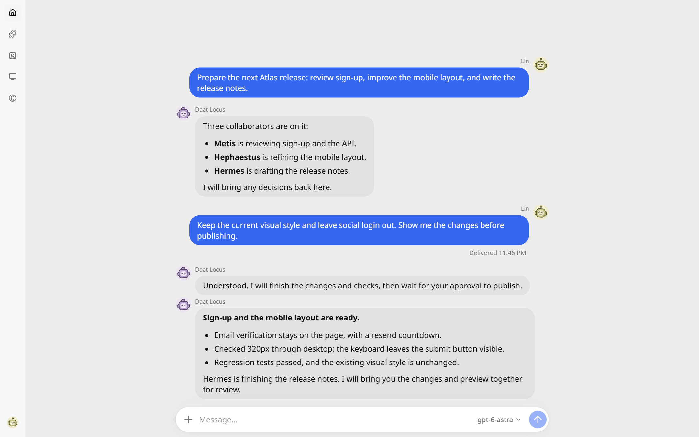

<p align="center">
  
</p>
<p align="center"><sub>All-in-one Agent platform</sub></p>
<p align="center"><a href="README_zh-CN.md">简体中文</a></p>

<p align="center">
  <picture>
    <source media="(prefers-color-scheme: dark)" srcset="assets/screenshots/home-dark.png">
    
  </picture>
</p>

## Features

- A unified, straightforward interface for moving tasks forward in parallel from one window.
- Connect devices into a distributed Agent network, or use a single device on its own.
- Virtual-screen ComputerUse across multiple platforms, so Agents can work with GUI applications without interrupting you.
- An Agent browser that also works as an ordinary browser.
- Very low memory use, even with several Agents working at once.
- An elegant, simple interface.
- Support for most LLM providers, including ChatGPT subscriptions.
- Full MCP support.

## Installation

Download a package from [Releases](https://github.com/shadow3aaa/DaatLocus/releases).

| Platform | Package |
| --- | --- |
| Windows x64 | Desktop installer; uses WebView2 |
| macOS | Desktop package; uses the system WebKit |
| Linux | Service archive; open the interface in a web browser |
| Android | APK with the service built in |

Browser and computer interaction need the native client. Linux supports the service and HTTP web reading; sandboxed commands need bubblewrap and working user namespaces. Android has no terminal or Sudo.

To build the browser entry from source, install [Rust](https://rustup.rs/), [Bun](https://bun.sh/), [wasm-pack](https://rustwasm.github.io/wasm-pack/installer/) and your platform's build tools:

```sh
git clone https://github.com/shadow3aaa/DaatLocus.git
cd DaatLocus
rustup target add wasm32-unknown-unknown
bun scripts/build-webui.ts
cargo run --locked -- serve
```

Open the address printed by the service. See the [native client guide](clients/app/README.md) to build the desktop app or APK.

## Connect devices

We recommend **Cloudflare Workers** for the relay; there is no server to maintain. Set your Cloudflare account and domain in `workers/signaling/wrangler.jsonc`, then run:

```sh
cd workers/signaling
bun install --frozen-lockfile
bunx wrangler login
bunx wrangler deploy
```

On each device, choose relay mode in account settings, enter the same public WSS address and sign in with the same Daat Locus account. A single device needs no relay. See the [relay guide](workers/signaling/README.md) for more configuration options.

## License

This project uses [Apache-2.0](LICENSE). License information for bundled open-source projects is listed in [third-party attribution](docs/license-attribution.md) and [NOTICE](NOTICE).
