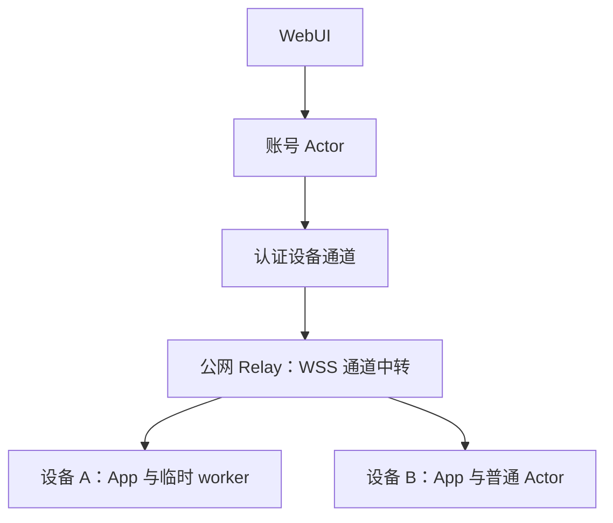

# 架构与接口

本文定义 Actor/App 系统的产品结构、执行与恢复策略，以及账号、设备和客户端接口契约。
工程约束见 [AGENTS.md](../AGENTS.md)；构建、测试与发布流程见[贡献指南](../CONTRIBUTING_zh-CN.md)。

## Actor 与 App

`Actor = Agent 核心 + 安装的 App 实例`。`src/actors` 负责串行收件箱、
模型执行、持久上下文、审批与回复；不同 Actor 并行推进。App 是唯一工具抽象，
各领域自行定义查询与操作，不要求统一 `get_state`。

业务数据不设固定总量配额：Actor 总数与所有权层级、导入对话的字节数、记录数和
消息数、MCP 安装与工具数、权限列表以及 Skills 的扫描数量和深度均不以
常量截断或拒绝。内容缓存按目标容量回收冷数据，但不因单个资源大小或活跃传输
超过目标而拒收；快照和恢复归档不设历史总字节数配额。分页、单帧传输、背压、
认证防滥用、模型预算、文件访问和授权校验仍各自生效，分页大小不是业务总量上限。

`src/builtin_apps.rs` 安装 Actors、Files/Skills、Terminal、Web、Artifacts。
工具描述和可移植输入 schema 留在所属 App；App 不提供常驻指令接口。
跨工具场景指导维护为 `src/builtin_skills` 中的按需 Skills，不拥有独立执行引擎。

Files 的 `search_text` 每次必须指定 `depth`（1–32；1 只搜索根目录直接包含的文件），
由 `ignore::WalkBuilder` 负责遍历、祖先规则发现和 `.gitignore` 匹配，默认跳过 `.git`。
启用 `parents` 和 `require_git`，遵循库的仓库边界与嵌套规则语义；未发现仓库时不应用
Git 忽略规则。启用全局 Git 忽略规则（由库读取 Git 配置和默认位置），
关闭隐藏文件过滤、`.ignore` 和 `.git/info/exclude`，不跟随遍历链接。
显式指定的搜索起点遵循库的根条目语义，即使被忽略也可直接搜索；正常遍历则跳过忽略内容。
`include_ignored: true` 关闭规则发现与过滤，也允许遍历 `.git`，不放宽文件访问权限。
仓库及全局规则的发现与加载是内部搜索元数据操作，不检查 Actor 文件作用域，也不申请审批；
规则文件的读取交给库，不再维护独立规则读取器或大小、链接策略。规则内容只供匹配，
不返回给 Actor，也不出现在错误详情中；库报告的加载错误以通用错误返回。
目录进入前检查 Actor 权限，搜索目标、普通文件读取和搜索返回内容仍执行
Actor 的文件权限校验；内部元数据读取不增加 Actor 权限。

服务实例在 profile 的 `runtime/temp` 下持有独立临时目录，用文件锁识别活实例，
正常释放时清理自身，启动时只回收确认失效的受管目录；持久 runtime、其他 profile
与旧工具输出池不属于此清理范围。内置 Skills 从编译资源原子发布到实例的
`skills` 子目录，普通 Actor 只注入摘要，通过 Files 按需读取，Core 跳过。
发布清单的精确文件经打开句柄与内嵌内容校验后可独立于请求读权限读取；
目录前缀、未打包文件、写入与原生进程执行权限均不因此放宽。
Windows、macOS、Android 各编译发布对应的 GUI use Skill，正文按需读取。
三端同时发布 `browser-use` Skill，指导共享标签、截图坐标、可复用观察引用、
用户同时操作与不确定效果恢复；复用同一发现与 Files 读取机制，不新增执行引擎。

Study 已移除。加载持久 Actor 配置时移除旧能力列表，普通 Actor 直接使用设备全量
App，Core 只构造 Actors App；保留身份、历史、输入和工作目录，不恢复旧应用。

`src/prompts/actors.md` 维护 Actor 编排、命名与会话引用指令，
由 runner 为 Core 和普通 Actor 独立注入一次，不依赖 App 安装集合。
`core.md` 仅用于 Core，并注入当前账号名；`approval_review.md` 仅用于审批评审。
这些角色指令不引入固定工作流、调度引擎或额外授权，权限与持久路由仍由代码执行。

Actor 的创建、工作目录与 App 安装集合是内部状态。客户端只修改模型偏好；沙箱范围
是账号在设备上的公共基础设施状态，所有 Actor 共享，不提供 Actor 权限或批准模式编辑器。
所有 Actor 持续
保留身份、配置、上下文与历史，没有单独删除入口。完成任务、退出账号、停止进程
或释放 App 资源不删除 Actor。

Core 的 Actors App 提供 `archive` / `unarchive`，仅响应 Owner 对目标 Actor 的
明确请求，不要求审批；协作者输入、历史材料和只读远程权限不能触发此操作，Core
本身不可归档。归档在目标宿主执行，与消息入队共用数据库事务：不要求 Actor
idle，尚待返回的委派不再阻塞归档；归档事务内丢弃排队输入（执行中的输入继续完成），
解档后不会执行已丢弃输入。归档状态持久保存，通过 ActorChanged
事件传播；保留身份、配置、上下文、历史、权限和资源，所有入口均拒绝新消息。
对话仍可查看，输入框显示已归档。取消归档只恢复接收消息，不恢复或重放旧工作；
重启、App 回收及模型配置变化不得取消归档。

Owner 可在账号设置中确认重置整个账号的工作数据：先停止执行与审批，再清空全部
Actor、会话、历史、内部资源与权限，并按初始策略重建 Core。模型配置、账号凭据、
设备身份及连接、撤销记录、Raft 投票与成员关系和工作目录文件保留。重置记录由具备
账号授权能力的设备签名，由当前有权管理账号的设备发起或转发，与本机数据清理在
同一事务中保存；签名设备后来被撤销不回滚已生效的重置。内部 App 与附件文件的
清理标记在重启后继续完成。重置按单调修订与签名设备排序，连接在交换业务数据前
核对重置代次，离线旧副本先清理后重连，不能重新导入旧历史、权限或重放操作。
Raft 中的新代次清空旧执行租约与工作 head，不重建投票或成员关系，并保留已同步设备
的本地恢复资格。重置不提供模型
工具，不允许按 Actor 删除；客户端须输入账号名确认，重置后清除会话草稿并返回 Core。

提供商始终可删除，关联模型一并移除；仍有效的默认和审批模型选择保留，失效选择
按模型列表顺序回退，审批默认继承主模型。配置持久化成功后，使用已移除模型的
Actor 偏好回到账号默认，其他配置与历史不变。删除最后一个模型可以保存为未配置
状态，排队输入保留、推理不启动；私密设备同步传播相同定义。HTTP 保存使用服务
所属 profile 的配置与备份，不依赖进程全局配置目录。

Chat Completions、Responses 与 Anthropic 的兼容降级记忆仅存于进程内，仅覆盖各自
已有的降级链；Chat 的普通推理与独立 JSON 请求共享成功的参数档位。缓存身份包含
协议、规范化 endpoint、完整模型配置以及
凭据和额外请求头的摘要；配置或租户变化不会沿用旧档位。冷探测与再次收到 400 后的
协商按身份单飞，只有 HTTP 成功才发布档位，热命中请求仍可并行。失败、取消和审批
模型的 deny 结果不改变原有错误或决策语义。条目空闲 30 分钟后失效；容量达到 512
时淘汰最旧的非使用中条目，进行中的协商不被淘汰。进程重启清空缓存，不持久化凭据。

OpenCode 与 OpenCode Go 是独立的提供商类型，共用 Console OAuth 登录与设备本地凭据，
默认分别使用 `https://opencode.ai/inference/openai/v1` 和
`https://opencode.ai/inference/go/openai/v1`，允许显式 URL 覆盖；名称不决定线路。
WebUI 切换两种类型时保留登录关联并清空 URL 覆盖。模型目录按线路选择，Go 不回退
到标准目录。HTTP 402 记为不可重试的计费失败，不自动改换线路。
OpenCode Console OAuth 在发送模型请求前解析工作区选择，成功后写回私有凭据文件，
由模型推理与模型目录查询共享。查询失败不发送缺少工作区标识的推理请求，也不缓存
不完整授权；保留认证、连接、限流与服务错误分类。凭据刷新先持久化新的令牌，
后续工作区查询失败仍保留已轮换的凭据。
Zen/Go 直接 URL 的 Chat、Responses 与 Anthropic 接口共享网关身份与失败分类；
模型不可用及地区拒绝立即终止，临时上游故障保留重试。工具别名只映射实际可用的
唯一 App 操作，保留设备前缀与原始约束，不补充不存在的执行能力。

Actor 的持久身份与 worker 驻留分离。启动、账号激活和恢复执行只查询有可执行
输入的收件箱；创建 Actor 和读取对话不会启动 worker。入队后按需激活，同一
Actor 仍只有一个串行 worker。没有输入持续 60 秒后，可安全重建的 App 关闭，
worker 与注册表条目释放；再次入队从 SQLite 加载配置、上下文锚点与历史。
空唤醒不延长空闲期限。收件箱的部分索引只包含排队输入，避免启动时扫描全部历史。

App 默认不允许空闲回收，必须明确声明自身可安全重建。Actors、Files、Artifacts
和只读 HTTP 缓存允许回收；终端保留会话或输出、浏览器保留上下文时阻止
回收，不杀进程、不丢页面或会话数据。终端使用随机唯一会话 ID，重建后不复用旧引用。
这些资源仍通过已有关闭操作或显式生命周期停止释放，空闲回收不重放 App 操作。
App 关闭期间 worker 仍占据注册表位置，关闭完成后移除并重查持久收件箱，避免
并行实例与丢失唤醒；暂停、重配置和退出在同一注册表锁下阻止新 worker。
共享 Core 的激活继续检查设备执行授权，无租约时保留输入而不驻留等待 worker。
Actor 列表在 SQLite 内按 ID 游标分页；容量、模型引用校验和私有目录边界查询
只读取计数、模型名或 ID，不加载全部配置。历史分页加载时直接借用消息计算预算，
只为通过预算检查的模型请求复制工作窗口，不为每页构造临时完整请求。

## Windows Virtual Workspace 基础设施

`crates/daat-locus-virtual-workspace` 是可独立构建的 lib crate，不依赖 Actor、
账号存储、WebUI 或 Tauri。Windows ComputerUse App 在服务内使用此库；Core 的
工具集合仍只有 Actors App。`driver/` 是自有 Rust `cdylib` UMDF 2.25 / IddCx 1.4 驱动，使用独立
Cargo 构建图；工作区 `xtask idd-driver` 准备固定版本/哈希 WDK、调用 Cargo 编译、
Inf2Cat 打包及签名，不使用独立 PowerShell 构建脚本。开发包默认复用本机
`.dev/windows-signing/` 中的开发身份，私钥备份仅当前 OS 所有者可读，并通过
CurrentUser DPAPI 保护随机 PFX 密码。构建只准备 CurrentUser/My 签名身份，
不建立系统信任；debug 安装 helper 在构建时固定对应公钥。release 构建必须
提供签名身份，发行 helper 始终固定仓库公钥，不接受开发身份覆盖或自动回退。
Windows 10 1903+ x64，驱动消费并释放 swap-chain 帧，桌面捕获由 lib 完成。
`DriverPackage::install` 经正常 PnP 安装一次驱动与持久适配器，需要 OS 管理员
权限，允许系统发布者确认。先注册根枚举设备节点再安装/绑定，首次安装不依赖旧节点。
库的普通部署 API 不修改证书存储；发行 helper 显式向 LocalMachine Root 与
TrustedPublisher 导入嵌入的专用自签名代码签名公钥证书，安装页面说明该行为。
helper 在导入前用固定公钥验证 CAT 签名，导入后验证 INF/DLL 的目录成员签名；
不接受包旁边的任意证书或调用方指定的信任身份。私钥不进入源码或安装包。
机器级互斥与按嵌入证书 SHA256 分隔的 HKLM 持久记录串行化安装、保留已有信任；失败回滚本次新增信任，
PnP 部分部署失败先回收新增驱动包，不能在驱动仍需重启清理时提前撤销信任。
Burn 按 CAT SHA256 和两处证书存在状态检测已部署版本，客户端 MSI 保持 per-user；
驱动 ExePackage 的 InstallCondition 在版本与信任均满足时跳过整个永久前置包，
Repair（Burn action 8）仍执行修复，实际部署保留安装文件缓存供维护。
只设置 DetectCondition 不足以跳过缓存：Burn 6 会缓存请求为 Present 的包，
在没有提权执行的计划中写入 ProgramData 而失败；也不应无条件计划机器缓存清理。
不通过放宽系统缓存目录权限解决此问题。
卸载某个用户客户端保留共享驱动。显式完整驱动卸载移除 DL 适配器和该身份的
所有已存储版本，再删除安装器拥有的信任项；已有信任不删除，需要重启时延后清理。
不修改 Secure Boot、测试签名、内存完整性或签名强制策略，首次下载提示仍可能出现。
安装/加载兼容性仍须在干净目标系统验证；自签信任不等于微软认证。
安装和证书管理不能暴露为 WebView 原生命令或 Actor 工具。

`VirtualDisplay::create` / `VirtualWorkspace::create` 不要求预先存在虚拟屏：
库通过设备接口 CreateFile / IOCTL 创建属于该文件对象的监视器，无管道、额外
守护服务、全局屏幕数量设置或心跳保活。适配器同时支持至多 8 个监视器。
驱动从 IddCxMonitorArrival 返回实际 adapter LUID 与 target ID，lib 按这两个值
匹配 DisplayConfig，不能按连接器索引、显示名称或“新增的第一个屏幕”猜测归属。
驱动协议使用固定宽度、版本化字节消息，不传进程指针或 Rust 原生布局。
自定义 IOCTL 经 IddCx 的 EvtIddCxDeviceIoControl 转发，不另建默认 WDF 队列。
DisplayConfig 的查询与配置统一使用 VIRTUAL_MODE_AWARE；旧式查询会映射 IDD 的
adapter/target，不能用于归属匹配。虚拟模式路径分别编码源、目标和 desktop-image
索引，保留其他路径的模式引用；间接显示由目标 base output technology 识别，
不能由驱动报告的连接器类型推断。
库在捕获、放置和输入前通过原文件对象查询监视器租约，防止设备恢复后复用的
LUID/target ID 被旧 workspace 误认领；关闭文件后排队的创建请求也必须拒绝。
支持 720p 至 4K 的五种 60 Hz 模式，
可配置分辨率和位置；SetDisplayConfig 保留其他活动路径及显式源/目标模式，不使用
全局 Extend、不允许自动改动其他输出模式，也不写用户的持久布局。重叠位置拒绝。
默认选择与独立物理屏相邻且未占用的位置，优先右侧，不把多个工作区排成依赖
前一屏存在的长链；找不到空位时要求显式位置。独立物理屏必须保持启用。

每个 workspace 独占一个非继承设备句柄。构造失败、析构或进程退出关闭最后句柄，
驱动 EvtFileCleanup 只拔除该文件对象的屏幕，显式 remove/close 等待输出移除。
正常 remove/Drop 先用 DisplayConfig 停用自己的活动路径、保留其余源/目标模式，
再关闭设备句柄，避免热拔除触发 Windows 重排其他输出；等待移除同时检查
targetAvailable 和路径活动标记。进程被强杀时没有这一步用户态停用过程，
由驱动文件清理拔除屏幕，布局变化仍由 Windows 处理。
睡眠/设备停机退休适配器代次及所有屏幕；旧句柄清理不能移除新代次屏幕，
恢复后不自动重放旧 workspace 的创建或输入。关闭屏幕不卸载适配器/驱动包。
attach 仅借用现有输出，
不能配置或删除该输出。DisplayConfig 的 adapter LUID、target ID 和 monitor device path 标识目标，
每次操作重新检查显示几何和拓扑；镜像输出以及没有独立物理显示器的环境拒绝连接。

窗口引用绑定 HWND、PID、进程创建时间、GUI 线程和观察时的物理像素几何。
只读枚举包含可见但最小化的顶层窗口，返回 `minimized`，不还原或激活窗口；隐藏的
内部窗口仍排除。发现与守卫安装使用 `validate_discovery`；截图和输入的 `validate`
仍拒绝最小化窗口。ComputerUse 接管按还原尺寸预留区域，在焦点守卫握手后，通过
异步 `SetWindowPlacement` 在虚拟屏坐标直接还原，重新观察后才能输入。按原位置
释放时也恢复原有最小化状态；显式交给用户其他位置时保持已还原。
放置窗口使用不请求激活的异步 SetWindowPos；调用方重新观察后才能输入，不隐式
还原最小化/最大化窗口。库保留 GDI 整屏诊断捕获；生产 ComputerUse 通过
`Window::capture` 使用 WGC 捕获指定 HWND 的合成表面，返回原始 BGRA 像素。
首次捕获仅从 System32 加载并固定 `GraphicsCapture.dll` 到进程结束，避免 WGC
内部回调在 COM 清理后进入已卸载代码；线程的 WinRT 初始化仍成对释放，每次观察
仍关闭并释放 frame/session/pool 和 GPU 资源，不保留捕获会话或空闲帧循环。
几何收敛只检查目标身份及目标窗口的几何，不比较用户桌面的光标、前台、焦点或
capture 快照来撤销输入。Hook/UIA 回执中的桌面快照是观察信息；后台输入成功与否
取决于目标协议、Hook 租约和 UIA 调用结果。用户在物理屏切换窗口、输入或拖曳
不构成虚拟屏窗口的失败。接管和调整允许应用按 DPI 缩小为预留区域内的稳定尺寸，
仍核对请求位置及完整边界；截图和输入绑定实际观察到的尺寸，不反复强制应用恢复请求大小。
归还允许应用按最小尺寸/DPI 调整大小，仍等待目标位置稳定。
真正未完成的归还保留 `handoff_pending` 枚举项及显式完成操作；只读枚举/状态查询
核对原身份和物理屏可见位置，清理已经完成的归还，不重放放置。成功后生成新的发现引用。
受保护、排除捕获或最小化窗口不保证可用，不以整屏裁剪回退。

输入通过 CreateSyntheticPointerDevice / InjectSyntheticPointerInput 创建真实
touch contact，由 Windows 命中测试、捕获并生成可用 GetPointerInfo 读取的
WM_POINTER 消息；不伪造 pointer 消息，不使用鼠标/键盘 SendInput 或恢复用户焦点。
此原生触摸路径与下面的可选 DLL Hook 路径独立。每个实例串行管理一个 contact 的
Down/Move/Up/Cancel，活动 contact 不能换窗。目标窗口必须完整位于工作区，
输入点必须命中其客户区；显示变化、窗口变化和遮挡均在操作前拒绝。
取消只释放自己的 touch 状态；析构随后回收自己拥有的屏幕，不关闭应用或删除 Actor 数据。

Windows 接受输入只代表接受合成帧，不证明目标应用已执行。输入前后分别观察
前台、键盘焦点和光标，跨操作比较前台/焦点；发现变化后中断后续输入，允许取消。
这些快照不能证明观察间没有瞬时焦点变化。WM_POINTERACTIVATE、触摸到鼠标的
兼容转换和目标应用行为仍可能激活窗口；原生触摸不提供独立键盘。
调试夹具区分自行处理 PA_NOACTIVATE 的 pointer-aware 窗口与默认激活
行为，前者通过不能推导第三方应用也通过。自建 IDD 上的默认 pointer 激活用例
也覆盖 WS_EX_NOACTIVATE：该样式不替代接收窗口处理 WM_POINTERACTIVATE。
库不修改目标窗口样式来声称焦点隔离。未知效果必须重新观察，不自动重放。

`hook/` 是普通 Cargo workspace 成员 `daat-locus-workspace-hook`，产出 Rust
cdylib；不修改系统 DLL、内核或目标磁盘文件。`WindowHook::attach` 热加载调用方
明确提供的 DLL，在目标进程的指定 GUI 线程安装 WH_CBT / WH_GETMESSAGE；
不安装桌面全局 Hook。当前仅接受与控制端相同架构的目标，且控制端必须处于
目标进程之外。`VirtualWorkspace::hook` 额外检查安装时目标完整位于工作区。
这一路径明确允许向目标进程加载 DLL；应用无需预先适配，但可能限制 DLL 加载。
CBT 在已安装 Hook 的 GUI 线程中，按真实窗口归属否决指定顶层窗口、子控件及 owned
窗口的激活/焦点请求；请求目标可以来自另一个 GUI 线程/进程。输入命令仍须在目标
自身线程执行。独立兄弟窗口不受该策略约束，不恢复用户焦点。守卫 close/Drop
先禁用策略，再卸载 Hook；不承诺立即卸载 DLL。

可视顶层窗口与输入表面分别建模。`InputSurface` 通过真实子窗口/owner 关系归属
顶层窗口，绑定自己的 HWND、进程创建时间、GUI 线程与 class；不要求内容与框架
具有同一 PID/TID。`WindowHook` 持有各实际 GUI 线程的租约，命令投递到对应表面，
重新观察时回收失效内容线程并发现新表面。归属判断不因相同 PID 授权独立兄弟窗口。
接管、观察和派发前，App 同样检查内容进程的自身进程/私有路径排除边界。
输入接收者绑定完整表面身份及新观察中的几何信息，不能仅凭 class 继续使用旧路由。

安装前读取目标二进制签名策略；纯 Hook API 对 Microsoft/Store-only 策略返回类型化
错误，而非等待无效握手或要求 Agent 重新点击。`WindowInput` / `VirtualWorkspace::input`
遇到该错误时为受限输入表面选择 UI Automation，保留其他表面的 Hook 路由。
每次输入前按接收者的原生身份确定后端；操作已经开始后绝不更换后端重放。
UIA 使用 `CUIAutomation8`，显式关闭 `IUIAutomation2::AutoSetFocus`，并设置有界连接/
事务超时；不调用 SetFocus。仍在允许注入的框架/内容线程保留 CBT 守卫，受签名策略
保护的内容进程不加载自研 DLL。真实 Calculator 算术验收与纯 Hook 签名策略拒绝
测试均属于独立库的 opt-in 原生测试；前者检查实际显示的 7 + 5 = 12、桌面输入保持
与撤权，后者检查拒绝发生在输入之前并回收部分安装的租约。

UIA 坐标从实际原生输入表面换算为物理屏幕位置，命中从已确定的接收 HWND 子树开始，
不能因同坐标的宿主兄弟窗口而重定向。跳过无操作模式的禁用装饰层，但禁用的可操作
控件仍拒绝执行。命中元素必须同时满足受控原生进程
身份和 UIA 树中的窗口归属。左键操作调用 Invoke/Toggle/SelectionItem/ExpandCollapse
模式，垂直滚动沿受控祖先查找 Scroll 模式，关闭使用 Window 模式；不调用测试端的
Invoke 来伪造生产输入。缺少模式在派发前明确拒绝。UIA 后端不声称支持通用按键、
插入位置 Unicode 文本或指针拖曳，也不把替换整个 Value 冒充插入文本；观察中的
supported_actions 反映已选定接收者的实际后端；尚未选定时保守公开窗口级能力。
COM 错误或目标 Hook 撤权停止后续输入并保留
未知效果，不恢复桌面状态来掩盖干扰。UIA 接口调用完成不证明任意软件的异步业务完成。

同一 GUI 线程只允许一个 Hook 租约。控制端与 DLL 通过会话内、默认 OS 访问控制、
非继承的命名文件映射交换版本化定长命令，无进程指针、管道或额外服务。
目标/控制端 PID 与进程创建时间、目标 GUI 线程、可视根窗口及其进程/线程身份、
传输表面、随机唤醒 token 共同约束操作；DLL 确认控制进程仍存活。
目标根窗口或传输表面销毁会禁用该租约。交还时先禁用组内所有租约，再逐一等待/卸载；
内容进程已退出后，系统移除其 Hook 不应阻止回收或重新绑定。
发布/认领/完成/取消以原子状态传递 payload 所有权，每条命令只认领一次；
超时取消尚未开始的命令，已开始的效果视为未知，禁用租约并拒绝后续输入，不重放。
首次握手确认回调确实在目标线程执行，不能把 SetWindowsHookEx 成功等同于可用。

Hook 文本操作在目标线程对明确子控件派发 UTF-16 WM_CHAR；键操作派发
WM_KEYDOWN/UP，并临时设置、恢复该 GUI 线程键盘状态，支持 Shift/Control。
它不执行应用消息循环的 accelerator 翻译，不提供 Raw Input、系统快捷键或
GetAsyncKeyState 虚拟化。鼠标操作按控件客户区坐标派发 move/left click/wheel
消息，不移动真实光标；click 的 down/up 在单次回调中完成。
`WindowHook::drag` 接受 2..=128 个 signed-16-bit 控件客户区坐标，先校验整条轨迹，
起点必须在客户区内，后续点可移出客户区。按下、携带 MK_LBUTTON 的移动和抬起
在单次目标线程回调中完成，不 sleep、不跨命令持有按键，不提供 OLE drag/drop。
手势守卫在异常结束时派发 WM_CANCELMODE，并释放仅属于目标窗口树的 capture；
超时仍遵守未知效果不重放约定。协议 ABI 为 4，旧 DLL 在安装 Hook 前拒绝。
关闭窗口也在追踪的目标线程命令内同步派发 WM_CLOSE，不遗留可在交还后执行的关闭消息。
已有鼠标 capture 时拒绝 click/drag；原生控件仍可能在同步手势内短暂取得真实
capture，因此不承诺用户同时拖拽的独立性。GetFocus/GetCursorPos 等查询没有虚拟化。
回执只证明派发及前后桌面观察，不证明任意应用执行成功或不存在瞬时干扰。
标准 EDIT/BUTTON/trackbar 的跨进程夹具只验证这些控件；默认触摸兼容转换在 CBT 拦截下
仍可能移动系统光标，不能作为无干扰鼠标后端。ComputerUse 使用 Hook 或 UIA 输入，不回退到触摸。

## ComputerUse App（macOS）

macOS 与 Windows 共用 `computer_use` 设备 App、工具名称、模型 schema、Actor
归属检查及设备桌面能力审批。Core 仍仅持有 Actors App；Android 保留 `phone_use`。
macOS 原生宿主位于独立的 `crates/daat-locus-computer-use` lib，不依赖 Actor、
账号存储、HTTP 或 Tauri。`daat-locus-client-protocol::computer_use` 定义有界通信
封包及 macOS Unix socket 客户端，不链接 AppKit / ScreenCaptureKit；服务只依赖此
协议。Tauri 客户端拥有原生宿主与系统授权身份，退出客户端释放窗口引用，独立服务
继续运行；GUI 操作必须等待客户端重新打开。启用后通过运行时绑定的私有
`CGVirtualDisplay` API 创建一块 profile 工作屏，不改动用户屏幕模式；接口缺失或输出、
模式发布未确认时拒绝输入，不回退到物理屏。客户端重开恢复已启用的屏幕。

Owner 在独立的“GUI 操作”设置中启用，再按弹窗授予辅助功能与屏幕录制。
授权按钮请求系统权限并打开对应隐私设置页，兼容系统不再重复弹出请求的情况。
macOS 打包默认复用 OS Owner 私有目录中的本地代码签名证书和独立钥匙串，首次
仅请求用户级代码签名信任；也可显式选择已有签名身份。签名覆盖配套服务及完整
应用包，证书身份不随构建改变；缺失或损坏时拒绝打包，不回退到 ad-hoc 或自动
换证书。由旧 ad-hoc 构建迁移仍需重新授权一次，后续同证书升级保持 TCC 代码身份。
启用、授权、状态与屏幕参数原生命令仅允许已认证 Owner 的主 WebView 调用，不向 JavaScript 开放截图、
AX 对象、进程或通用系统调用。启用状态按设备 profile 原子保存；关闭先撤销新的
输入准入，并在已开始的调用结束后逐个归还窗口、清理引用和移除屏幕。
高级参数支持像素宽高及 1×/2× 缩放，确认后归还接管窗口并在同一显示器编号上重配；
新模式确认且偏好原子保存后才返回成功。失败保留待清理引用并拒绝后续输入；不重放
窗口操作，Owner 可重试。参数单独保存在 profile 的 `computer-use-display.json`。OS 授权撤销时后续操作拒绝，不替用户
修改 TCC、系统安全设置或提示授权。完整后台截图需要 macOS 14+；旧系统仍可运行
客户端，GUI 功能返回不可用。

原生宿主通过 profile 私有的 `runtime/computer-use.sock` 接受服务请求，socket
权限为 0600，双方核对 OS UID、`LOCAL_PEERPID` 及伴随可执行文件的精确路径。
请求不超过 64 KiB，回复不超过 48 MiB，连接有时限及并发上限。每个 Actor 保留独立
会话、单调执行 epoch、不可猜测的应用/窗口/截图引用；窗口获取不能跨 Actor，
获取窗口时记录原始几何并通过 AX 移到工作屏，交还、释放或会话变化时送回用户屏；
归还未确认前保留独占租约并撤销输入。旧引用失效。取消、过期 epoch、权限关闭和陈旧图像在发出下一项
原生操作前检查；已开始的输入或启动若结果不确定，返回 `outcome_unknown`，禁止重放。

截图使用 ScreenCaptureKit 的单窗口过滤，允许遮挡窗口，隐藏真实光标；最小化
窗口不作为实时来源。完整窗口、裁剪和放大均有 800 万像素上限，输入从返回图片
像素映射到 AX 桌面逻辑点。输入前核对原进程启动身份、原生窗口编号、AX 窗口对象、
几何及可访问控件状态。窗口编号绑定使用可选 `_AXUIElementGetWindow`，系统不提供
该符号时拒绝精确绑定，不猜测同名窗口。

当前输入路由为 AX 原生控件操作：按钮 Press、显式选定可编辑控件的 Unicode
插入与受支持的编辑键、可写滚动条、滑块拖动，以及窗口位置、大小、恢复和关闭。
观察返回有界控件事实与支持的操作；自绘控件、不支持的键或轴拒绝输入，不回退到
全局 CGEvent、剪贴板、激活窗口或移动物理光标。后台启动使用
`NSWorkspace.OpenConfiguration.activates=false`，仅获取该次新进程唯一确认的新窗口；
已运行应用要求先枚举窗口。每项原生调用比较前后台应用及真实指针，变化时报告
需要重新观察，不做“抢焦点后恢复”的补偿。目标应用主动弹出或激活窗口仍可能
导致结果不确定，不能据此声称所有应用均支持无干扰输入。

## ComputerUse App（Windows）

Windows x64 提供 `computer_use` 设备 App，普通 Actor 按现有规则获得，
Core 仍仅直接持有 Actors App。macOS 复用同一个 App，Android 使用 `phone_use`。
采用窗口定向的“发现、选定、观察、单次操作、再观察”交互；工具沿用现有 App
执行机制，不新增 JavaScript REPL、工具引擎或 Actor 类型。

Agent 不管理驱动、DLL、显示器编号、分辨率、Hook、HWND 或设备 IOCTL。
接管窗口时，App 在服务准备的共享虚拟屏中分配独立窗口区域并建立输入租约；运行资源由
专用 Windows OS 线程持有，App 通过有界类型化请求串行调度。共享设备注册表
协调窗口/GUI 线程租约；冲突返回 busy，不让两个 Actor 同时操控同一目标。
服务不创建展示窗口，不依赖 Tauri 事件循环，也不新增常驻管道服务。

### 工具与窗口生命周期

工具前缀为 `computer_use__`。Rust 输入类型使用
`model_schema` / `model_schema_for`，可选属性使用 required nullable 字段；
轨迹点使用 `{x,y}` 对象数组，不使用坐标元组或带 payload 的动作联合类型。

| 操作 | 输入要点 | 行为 |
| --- | --- | --- |
| `list_apps` | query、cursor、limit | 有界枚举可发现应用，返回 opaque app_id 和名称 |
| `list_windows` | app_id、cursor、limit | 有界枚举具体窗口，返回 opaque window_id、标题、归属、模态关系和接管状态 |
| `launch_app` | app_id | 先分配虚拟屏区域再启动；唯一、可归属且已出现在虚拟屏的新窗口直接接管并返回截图，否则返回未确认结果 |
| `open_window` | window_id | 明确接管这个窗口，放到虚拟屏、取得 Hook 租约并返回首个观察 |
| `get_window_state` | window_id、region、scale | 默认返回完整窗口截图；支持窗口内区域和整数放大，返回 state_id、可用操作和输入接收目标 |
| `adjust_window` | window_id、state_id、action、width、height、x、y | 非激活调整受控窗口：resize、move、fit、restore；返回完整窗口观察并清除旧输入路由 |
| `click` | window_id、state_id、x、y、button、click_count | 根据观察坐标解析实际控件并派发点击 |
| `type_text` | window_id、state_id、text | 向已选定的窗口内输入接收目标提交字面 Unicode 文本 |
| `press_key` | window_id、state_id、key | 向该输入接收目标派发按键或组合键 |
| `scroll` | window_id、state_id、x、y、delta_x、delta_y | 在指定位置解析接收控件并滚动 |
| `drag` | window_id、state_id、path | 在当前返回图像坐标中执行有界左键轨迹，由宿主转换裁剪和倍率 |
| `give_window` | window_id、state_id、placement | 撤销控制引用并向物理屏交还窗口；支持原位、居中、左半屏、右半屏 |
| `release_window` | window_id | 释放接管、Hook 和输入路由，不发送关闭应用指令 |
| `close_window` | window_id、state_id | 明确请求关闭该窗口，可能产生未保存确认对话框，不结束整个进程 |

`open_window` 是明确改变窗口位置的操作；枚举和观察不自动接管。运行中的应用
可能只有用户正在使用的窗口，不能因应用名匹配就移动它。启动也可能被应用转交给
已有实例；启动前记录所有顶层 HWND（包括隐藏窗口），返回候选来自真实枚举，
不把原有窗口重新显示冒充新建窗口。新窗口按启动回执的 PID/进程创建时间，或
Shell 目标 AUMID 与根/实际托管内容进程的系统应用标识对应；不能仅按标题或启动
期间全局新增窗口猜测归属。回执不含服务凭据。
启动前即建立共享虚拟屏并保留区域。临时自身子命令在清理的环境中启动：EXE 用
CreateProcessW 的 STARTF_USEPOSITION/STARTF_USESIZE/STARTF_USESHOWWINDOW 设置初始坐标、尺寸和
SW_SHOWNOACTIVATE，不继承句柄；Shell App 使用虚拟屏内隐藏非激活 owner，传入
SEE_MASK_HMONITOR 和目标 HMONITOR。不将虚拟屏设为主屏，也不通过设置用户光标/
前台来选择启动位置；首次增屏仍受 Windows 热插拔重定位边界约束。
在虚拟屏上确认唯一、可归属的新窗口后，沿用这次分配区域取得输入租约并返回首个
图像；无需模型再调用 open_window。应用仍可覆盖启动位置/激活提示或复用已有实例，
此时返回 outcome_unknown，不自动挪动用户原有窗口，也不通过事后恢复前台掩盖问题。
启动提示不是任意第三方应用首帧位置的强制隔离；观察位置与首次显示测试分开验证。
当前 Calculator 会忽略 Shell 显示器提示并激活到物理屏；此类启动未满足首帧虚拟屏
要求，按未确认结果处理，不能因其他 EXE 的首次显示测试通过就宣称通用支持。
启动、接管等改变状态的操作在需要观察确认时也返回当前窗口观察。

窗口 ID 由宿主登记，绑定设备、Actor、租约代次及真实窗口身份；不能由模型构造
原生句柄。进程创建时间、GUI 线程、窗口销毁和几何变化继续在执行时校验。
owned 模态/弹出窗口作为相关窗口返回，具有各自 window_id 和截图；不能按 PID
自动授权整个应用的全部窗口。新模态需要识别归属、纳入工作区并停止向被阻塞的
父窗口输入。当前只共享同 GUI 线程的 owned 窗口族 Hook；同线程独立兄弟窗口不能
同时接管，跨线程对话框的关系也不能按 PID 猜测。

`release_window` 不等于关闭应用或 Actor。释放前处理目标的输入状态并移除 Hook；
借用窗口按记录的有效原位置非激活归还，无法归还时保留明确的释放失败状态，不能
声称应用已关闭。`give_window` 和 release 都先把同线程受控窗口族从控制表移入
待交还表，清除输入路由和 state_id，再禁用 Hook、取消未开始的命令，等待已开始的
命令返回后卸载 Hook 并非激活移动窗口。等待超时返回 handoff_pending，保留禁用的
守卫和显示，允许 release 无 state_id 重试清理；旧 ID 只允许查询交还状态，不能再
截图、输入、关闭或重新接管。
交还完成后只有重新发现得到的新 ID 才能显式接管。移动失败保留待交还状态。
共享虚拟屏由服务基础设施持有，独立库 `SharedDisplay` 的专用线程管理 IDD 句柄。
Windows Bundle 在驱动及 MSI 执行前，由非提权的缓存 CLI 通过 OS-owner IPC 正常停止
当前安装在账号 namespace 下默认及命名 profile 的运行中服务，等待进程与客户端退出，
释放显示设备及安装文件。启动锁覆盖服务初始化至控制端点发布，私有事务记录阻止
安装期间重新启动同一安装的服务。完成后按原监听地址、工作目录与 profile 恢复原来
运行的服务及客户端；不启动原本停止的 profile。MSI 回滚前再次停止已恢复的进程，
回滚完成后恢复旧安装；失败的准备步骤自行恢复。崩溃遗留记录不永久阻止启动，重试
安装保留此前已停止的服务参数。此协调不提权、不重放已开始的 App 效果，也不替代
Windows 对其他用户或外部进程持有设备句柄时的真实重启要求。
Windows 服务在本机 GUI 操作已启用时，于对外就绪及激活 Agent worker 之前显式创建屏幕并等待工作区布局稳定，
不等待首次工具调用；默认同一服务进程的全部 Actor/System 复用一个输出。
用户输出通过显示适配器 PnP 硬件身份与 DL 自有 IDD 区分，不用 `indirect` 一概排除；
远程/间接用户屏同样可作为布局锚点和交还目的地。建屏仍要求至少一个非 DL 用户输出，
并保留现有输出及其模式；DL 工作屏不能充当自己的用户输出前置条件。
驱动不可用时记录启动诊断，其他服务功能继续工作；后续 ComputerUse 操作仍按实际
驱动状态返回错误，由 Owner 在 GUI 操作设置中重试；不将启动预热当成桌面操作授权。账号维护命令不创建屏幕。
共享 WebUI 的 `/virtual-displays` 仅供 Owner 观察已有本机工作屏。
`GET /v1/device/virtual-displays/capabilities` 决定导航入口；同路径的列表及 `/{id}/frame`
分别返回有界屏幕目录和内存 PNG，沿用 Owner HTTP 授权，图像返回前再次验证会话，禁止缓存。
Windows 在 SharedDisplay owner 线程内校验输出身份和几何后捕获完整工作屏；
macOS 通过经过同伴进程校验的只读原生协议枚举本客户端持有的实际在线输出，以
ScreenCaptureKit 过滤该显示器截图，不枚举或回退到用户物理屏。
Android 枚举已有 Actor 工作屏，以独立租约 ID 选择屏幕并读取现有 ImageReader 帧，支持切换。
这些接口不创建、恢复或重配虚拟屏，不请求权限、不重连 PhoneUse，也不改变 Actor 的
输入/截图引用和窗口所有权；没有物理主屏回退及鼠标、键盘等输入接口。
页面顺序低频拉取，前一次完成才安排下一次；离开页面或进入后台时中止刷新和丢弃迟到响应。
屏幕消失、关闭或授权失效时清空画面；图像按比例完整显示，不裁切，不写入 Actor 资源账本。
设置页的 GUI 操作分类按服务能力显示 Windows ComputerUse 或 Android PhoneUse 内容；
macOS 原生客户端显示开关、辅助功能与屏幕录制授权引导及屏幕宽高、缩放高级选项。
授权弹窗在可见时及应用回到前台时重新检测；权限齐全后仅为已经启用的 GUI 操作
续接虚拟屏初始化。Owner 关闭 GUI 操作或离开页面后，迟到的检测结果不能触发初始化。权限以
当前客户端进程的系统检查为准；系统列表中残留旧签名的开关不代表当前构建已获授权。
Windows 通过 Owner HTTP `GET/PATCH /v1/device/computer-use` 读取及串行修改本机开关和
驱动支持的分辨率；沿用账号授权、可信 Origin 与请求头，不新增 WebView 业务命令。
偏好保存在服务 profile 的 `computer-use.json`，不复制到账号或写入 Actor 配置。
为保留已有行为，缺省启用且使用 1920×1080；关闭后服务启动不创建屏幕，工具不能启用它。
变更时阻止新输入，等待当前操作结束并逐个归还已接管窗口，撤销旧窗口/截图引用；
普通 Actor worker 继续运行，不重放 App 操作。关闭后移除屏幕；调整分辨率时在原输出上
重配，窗口归还失败则保留显示和清理守卫、关闭操作准入，Owner 可重试。显示调整及偏好
持久化均成功后才发布新偏好；持久化失败回滚到之前确认的显示状态，无法确认则继续拒绝操作。
独立库 `SharedDisplay::initialize()` 支持无窗口区域的显式初始化，重复调用不重配输出；
普通库构造仍不改显示拓扑，未显式初始化的调用方在首次分配区域时创建屏幕。
交还最后一个窗口、App shutdown、模型切换和 App 空闲回收不拔屏，不重新配置
分辨率/位置。App 仅 attach 借用工作区，窗口保留 `DisplayRegion` 直到交还完成。
服务持有者全部退出后，仍有窗口区域时继续保留屏幕；最后的持有者和区域释放后
才正常移除。若输入仍在执行，后台清理线程继续等待，不能提前暴露窗口。
Owner 关闭 GUI 操作、服务进程退出或驱动卸载仍会拔屏；本接口不是跨进程/profile 的常驻屏幕代理。
异常退出导致的窗口重排仍遵守 Windows 热拔除边界。窗口租约、待交还窗口或 Hook
阻止 App 空闲回收；服务持有的空屏不阻止。驱动/显示失效时，存在区域就拒绝重建；
所有区域释放后下次显式接管才允许恢复，旧图像、路由和输入效果不重放。

共享屏幕在 Windows 工作区（避开任务栏）内优先寻找空位；放不下时按有界偏移层叠，
不因其他窗口占用拒绝新增接管，不缩小已有窗口、不增屏、不调分辨率、不移动其他 Actor 的窗口。
区域是窗口放置/生命周期租约，可相互重叠，不能作为独占像素或输入授权。尺寸调整尽量保留原位置。
执行和观察检查窗口仍位于租用区域；旧/新区域在确认移动前均保留其租约。
首次创建等待 Explorer 的工作区布局稳定，避免任务栏稍后出现后压缩已分配区域。
截图使用指定 HWND 的 WGC 合成表面，被遮挡仍可观察，不混入覆盖窗口的桌面像素。
每次请求按需建立 free-threaded frame pool、取帧并关闭 session/pool；空闲不连续捕获。
DWM 扩展边框与 GetWindowRect 的差异以空白边框补齐，保持完整窗口物理像素坐标；
内容尺寸或窗口几何变化、未知表面尺寸、取帧/GPU 映射超时均拒绝发布，禁止整屏截图回退。
宿主串行化原生操作的准备、校验、输入和后续观察，以及设置关闭/交还的清理；推理不持锁。
Hook 命中从目标根 HWND 递归检查可见子窗口，不使用全局 WindowFromPoint；禁用控件或模态父窗拒绝。
UIA 从目标 HWND 的 RawView 子树按图像点命中，逐次验证真实 HWND/owned 关系，不按 PID 推断归属。
提供者把覆盖控件报告为 offscreen 时，可在操作前非激活提升该窗的普通 Z-order，再重新检查；
不设置 topmost、不恢复用户焦点、不在派发后切换后端或重放。原生 WM_POINTER 路径保留全局遮挡检查。

### 观察、坐标与输入目标

`get_window_state` 的语义结果包括 window_id、state_id、标题、实际图像 width/height、
完整窗口 window_width/window_height、相对完整窗口的 client_area、view.region/scale、
虚拟屏本地 workspace 尺寸和 window_x/window_y（不含系统绝对坐标）、
截图资源引用、input_target、related_windows 和 supported_actions。
默认截图包含完整窗口（标题栏、边框、客户区），原始分辨率；region 为完整窗口内的
像素矩形，scale 为 1..=4 的整数倍率，均为空时恢复默认。越界裁剪直接拒绝，不返回
残缺图像；图像至多 8 百万像素。弹窗单独标识，不让 Agent 估计系统坐标。
坐标以实际返回图片的左上角为原点，使用图片像素。App 保存裁剪/缩放、DPI、
客户区/屏幕/子控件变换，在执行时完成转换，不把 HWND 或显示坐标推给 Agent。
新观察撤销旧坐标；输入完成后的默认观察恢复完整窗口。非客户区可见但不能作为
鼠标输入接收面，标题栏管理使用 adjust_window。当前视口外的内容需要滚动或调整窗口，
截图放大不能显示应用没有渲染的文档内容。

`adjust_window` 的 resize 使用完整窗口尺寸，move 使用相对虚拟屏的 x/y；fit 选择
整个屏幕可用工作区，restore 恢复到现有保留区域，未使用参数必须为空。state_id 通常绑定
最新观察；无法截图时允许显式传空恢复。宿主保留新旧区域直到实际位置确认，移动
超时不释放任一可能区域、不自动重放。最大化窗口在既有激活守卫下还原再非激活移动；
接管最大化窗口也使用这条路径。不重建屏幕、不改变分辨率、不挪动其他窗口。
调整后清除接收目标并返回完整窗口观察；焦点、前台、捕获或光标变化停止输入，
不通过恢复用户桌面掩盖干扰。
原生放置只发送一次，随后有界等待目标几何稳定；不因系统或应用自行重排而反复移动。

首版以截图为主，不虚构可访问性树。UIA 以后可增加真实的 element_ref 和语义
操作；在实现前不发布 set_value、secondary_action 或伪造的元素索引。
截图通过现有 Actor Resource ledger 和工具 model_images 返回，进入模型视觉
内容；工具 payload 不塞 base64，客户端事件只传引用，展开时再读取重资源。
不支持视觉的模型收到明确能力错误，不能先执行动作再发现无法观察。

每次坐标/输入操作必须带对应窗口最近的 state_id。它绑定截图坐标变换和输入
代次，其他输入、重新接管或窗口/模态变化使旧引用失效。它不冻结应用，也不能
证明截图后像素未变化；执行前仍需检查身份、几何、命中控件和阻塞窗口。
普通异步动画不应因逐帧像素 hash 不一致而导致操作永远被拒绝。

每个输入工具完成后自动采集并返回新观察，Agent 看过新观察再决定下一步。
不提供盲目的多动作批处理；一个 drag 的完整轨迹仍算一个输入动作。
直线拖曳只需给起终两个点，中间移动由宿主采样；曲线任务给折线点，不能要求
模型机械计算插值。滚动量使用滚轮刻度，正 delta_y 向下、正 delta_x 向右；
宿主转换原生方向/单位，不承诺应用会移动精确的文档像素距离。
截图反映当时画面，不保证应用完成业务操作。等待加载时再次显式观察，不使用
模型轮询运行时全量快照或后台连续截图注入对话。

`input_target` 是 App 记录的明确派发目标，不是 Windows 前台焦点。
点击通过原生命中测试解析控件并更新此路由；派发文本/按键前重新校验它仍属于
接管窗口。观察会说明路由目标及其边界，但不会把“点击过某控件”等同于编辑器
已获得内部焦点。尚无有效输入目标时返回错误，不把文字发给用户当前编辑框。
App 以 HWND、控件类名和几何记录路由并执行校验；lib 接受明确控件 HWND。

`press_key` 使用可移植按键名称（如 Enter、Escape、Ctrl+A）；后端
明确报告实际支持范围。当前 lib 的 Shift/Control 消息派发不等于 accelerator
消息循环、Tab 导航或系统快捷键均已实现。未支持的按键、右/中键、水平滚动等
在作用前返回 unsupported，不能退化成用户桌面的 SendInput 或激活窗口。
不提供 `activate_window` 逃生通道。`type_text` 提交最终文本，不模拟拼音输入。
首版仅单次左键、纵向滚动、Shift/Control 组合及有限导航键，文本每次最多
1024 个 UTF-16 单元；拒绝 Tab、Alt、Win、双击、其他鼠标键及水平滚动。

### 结果、授权与集成边界

输入结果区分 not_started、dispatched 和 outcome_unknown，附派发回执、当前
观察或 observation_error。派发成功但截图失败属于未知结果；超时、取消、
重启或设备失联不自动重放输入。窗口应用卡住也可能阻塞它自身的 GUI 线程，
不能把库中的有界消息数量描述为任意应用都会按时返回。
窗口/观察引用属于创建它们的设备和宿主代次，不能随 Actor 迁移到另一台设备
后继续使用。恢复保留 Actor 历史和截图资源，重新发现实际窗口，不自动重启应用。

ComputerUse 的可用性由设备启用状态和原生 OS 能力决定，不定义动作审批、
授权指纹或 Actor 权限记录。每次操作仍执行设备身份、目标与原生后端检查。
目标 GUI 应用保留其 OS 用户文件权限，是设备文件沙箱的原生能力边界：任意宿主 GUI 可读取/修改该 Windows
用户能访问的文件，不能声称隔离了服务凭据或其他 Actor 的磁盘数据。此例外不修改
传给 Files、Terminal 或其他 App 的沙箱。设备 epoch、认证只读远端拒绝、DL 自身
进程/窗口排除仍逐次检查；截图资源继续由 Actor HTTP 授权保护。模型指令不替代隔离。

原生 Windows 打包包含版本匹配的 Hook DLL 和驱动部署包，普通 Cargo lib 构建
仍不自动调用 WDK。安装器负责正常提权的签名驱动部署/修复，模型不运行管理员
命令或管理证书。现有客户端 per-user MSI 与机器级驱动部署分别处理，不把
整个客户端悄悄改成管理员常驻程序。发行前仍需验证真实签名包、升级/回滚、
驱动稳定性及应用兼容性；本节不是对这些验证已经完成的声明。

显示拓扑配置的实测边界：创建/移除自有 IDD 屏幕时，Windows 可将系统光标重定位
到主屏中央，物理输出模式未变也可能发生。这不是 Hook 鼠标输入造成的移动；
App 不通过事后 SetCursorPos 掩盖此行为。目前不保证屏幕生命周期期间光标位置不变。
输入/WM_CLOSE 处理器若进入同步模态循环，会使命令保持执行中；超时后输入停止，
交还保持 pending，直到处理器退出。跨线程模态与任意应用兼容性尚未得到完整验证。

## PhoneUse App（Android）

Android 提供 `phone_use` 设备 App，普通 Actor 获得，Core 仍只直接持有 Actors。
Owner 在独立的「GUI 操作」设置页启用设备能力，并选择 Shizuku 或 Root。
Shizuku UserService 使用已授权的 ADB（UID 2000）身份；Root 使用
librootkotlinx 的 RootSession/RootCommand（UID 0）。Rust 服务、Files 和其他 App
仍在普通应用 UID 中运行，不获得 shell、任意 Binder 或 root 文件系统接口。
原生配置命令只接受可信主 WebView，并逐次检查当前 Owner 会话。
模型工具不能启用或更换授权方式。设备保存 Owner 的启用选择和授权方式；进程启动、
回到前台及 Shizuku Binder 重新到达时，基础设施自动恢复已选择的传输，不因进程重启
关闭开关。RootSession 复用 Magisk 等管理器的持久授权；Shizuku 自动恢复先核对已有
授权，不主动弹出权限申请。实际授权失效时保留启用选择并显示不可用，由 Owner
重新授权。显式关闭会持久化并阻止迟到连接恢复；旧 Binder 回调不能改写新连接。
恢复仅执行能力探测，清除旧图片与资源引用，不重放任何 GUI 操作。

已验证的显示隔离策略要求 Android 15（API 35）以上；旧版本明确拒绝。
每个 Actor 持有独立的虚拟屏幕，默认 1280×720、160 dpi，启用独立焦点、
禁止抢占全局焦点、隐藏 IME 策略与随屏销毁任务的 flags，并检查实际显示标志、
display unique ID 和存活状态。普通窗口的发现、截图、触摸和按键仅限该屏幕。
不移动用户主屏任务，不接受模型提供的 display ID，不回退到主屏输入。
截图通过 ImageReader 获取，再以 FD 传给普通 UID；Rust 将其发布到既有
Actor 资源账本，客户端和模型沿用相同的授权资源契约。
GUI 操作的高级设置通过独立 Owner 原生命令串行保存设备本地的宽度、高度和 DPI。
宽高为 256–4096 的整数，单屏及存活屏幕总预算均不超过 800 万像素，DPI 为 80–640。
建屏及调整尺寸时核对系统实际尺寸和 DPI。高级设置先保留草稿，Owner 点击应用后
原地调整已有 VirtualDisplay 和图像接收器，不增加屏幕或重放任务；旧窗口和截图引用
全部撤销，需重新发现和观察。失败时回滚已调整屏幕；无法确认回滚则关闭操作准入，
由 Owner 重新连接。配置持久化失败同样回滚尺寸；仅在确认调整与持久化均成功后发布
新偏好。模型不能修改这些偏好或覆盖请求中的建屏参数，失败或校验失败保留界面草稿。

工具前缀是 `phone_use__`，沿用发现、接管、观察、操作、再观察流程。
launcher app_id、window_id 和 state_id 都是宿主生成的 opaque 引用。
启动前记录实际 task 集合，只有确认目标包在自有屏幕出现唯一新任务才返回成功；
应用拒绝多屏或复用已有任务时返回 outcome_unknown，不能盲目重新启动。
已知 singleTask / singleInstance launcher 在派发前拒绝。应用内部后续导航仍可能
调用系统单例路由；任意第三方应用的导航兼容性并无全局保证，目标身份变化后必须
重新发现，不能继续使用旧窗口引用。
输入前校验 Actor、执行代次、任务、无障碍窗口与根节点身份、几何、遮挡和最新观察。
取消在独立通道关闭未开始的操作；进行中的手势释放触点，未知效果不重放。
截图支持窗口内裁剪与 1–4 倍放大，输入坐标始终相对返回图像。

Android 不提供 Windows 的 adjust_window、give_window、type_text。
点击选择实际可编辑节点；`set_text` 通过 ACTION_SET_TEXT 替换完整 Unicode 文本，
返回控件实际文本，不模拟第二套输入法。自定义不支持此操作的控件明确失败。
按键只接受实际支持的有限导航键，触摸只支持单次左键、纵向滚动和有界拖曳。
release_window 撤销旧引用并保留任务，重新发现后需显式 open_window。
新虚拟屏显式设置并核对 DISPLAY_IME_POLICY_HIDE，禁止副屏编辑器连接或迁移主屏输入法；
文本输入走所选控件的 ACTION_SET_TEXT。close_window 移除选中任务，不调用 force-stop；Android 可在最后一个任务关闭后
异步回收缓存进程，关闭回执有界等待这次回收，避免立即重新启动时进入正在退出的进程。
普通 App detach 保留有任务的屏幕；
Owner 关闭连接或执行账号工作重置时释放屏幕及任务。无任务的 detach 回收空屏幕。

PhoneUse 使用实际的 Android UID、Shizuku 或 Root 原生能力边界；工具没有额外审批声明，
不记录 Actor 权限或操作指纹。每次操作验证当前权限来源及 UID，失效时拒绝执行。
只读远端拒绝、DL 自身应用排除与设备执行授权始终有效。
目标 GUI 应用保留其 Android 用户权限；本能力不声称为目标应用提供文件沙箱。

## 执行与恢复

App 参数和实际执行校验失败只完成该次工具调用并反馈模型；
不把可纠正的调用错误升级为输入中断，不跳过同组独立调用。持久化失败、
输入执行权限失效、取消和生命周期变更仍可终止输入，未开始的效果不自动重放。

SQLite 的事务同时提交消息变化和语义事件，稳定 ID 标识输入、工具调用、资源
和审批；全局事件游标单调递增。协作消息持久化后在安全边界立即接收，结果关联原请求、原来源和交付
引用。入队时保存权限上限，接收者之后新增的权限不能被旧委派使用。
ActorStore 的同步数据库调用在多线程 Tokio 上使用阻塞边界：在等待数据库锁之前
交还 scheduler，直到查询或事务提交完成后才返回，避免读取、鉴权和 Raft 落盘
共同耗尽异步 worker。FULL 持久化、提交顺序和不可取消的同步事务语义保持不变；
单线程 runtime 与普通同步调用仍同步执行。慢访问只记录源码位置和耗时，不记录数据。

Actor 数据库使用 SQLite 自身的容量上限，不设置账号历史的固定 1 GiB 配额；
事件分页、单块文本和同步帧仍保持有界。模型进度的正文与思考事件只包含新增文本，
提供商在每次请求内分别记录已发送的 UTF-8 字节位置，结尾只补发未发送的尾段。
Anthropic 按通道缓冲实际增量；runner 合并增量后分块持久化，禁止把累计全文作为
增量重复追加。新请求和重试重新建立发送位置，草稿重置划分独立 generation。

核心使用同一个串行 inbox 和 Agent 循环，以短回合协调。Actors App 的 `deliver`
创建独立的 `delivery` 消息，其来源与收件人从当前输入构造，模型只能提供正文与
`finish_turn`。交付 ID 由 Actor、输入和调用 ID 确定，相同调用不会重复发送；
核心先保存交付记录并提交账号账本，再幂等发布消息事件和远端交付；未提交记录不进入会话查询，也不能作为恢复成功的凭据。`finish_turn=true` 在
整个工具协议组写完观察后关闭当前输入，无需再调用模型；不结束任何被委派工作。
已有显式交付时，最后的模型文字只关闭回合，避免重复用户消息。没有显式交付的
直接最终回答仍沿原收件人交付。普通 Actor 的 `report` 将重要进展关联原请求，
作为 `progress` 输入唤起请求方，而不修改执行中任务的状态。Core 自行选择汇报内容。

Core 的用户输入按 IM 消息立即持久化并返回，不等待当前输入执行完成。新用户消息
到达时丢弃尚在进行或重试等待中的旧模型请求；已开始的工具协议组先完整结算，
随后静默结束旧输入，以保留的历史和新输入继续推理。此切换不取消委派、回收 Actor
或重放已完成的 App 操作；每条新输入保留自己的身份与权限。协作者进度本身不抢占
推理。Core 输入框始终提供发送按钮，不显示终止任务按钮；普通 Actor 保留任务控制。

所有 Actor 的 Actors App 提供 `yield`：成功观察持久化、当前工具协议组完全结算后，
只关闭当前 inbox 输入，不生成最终正文、占位结果或远端交付，也不再请求模型。
它保留 Actor 身份、上下文和委派关联；后续协作者输入仍沿原请求唤醒并汇总。
`Completed` 表示该输入处理结束，不能据此断言其委派目标已全部完成。等待必要协作
时使用简短的重要进度和 `yield`；必要结果整合验证后才发送完整最终答复。
无新增事实的确认、重复发现及汇报后的常规回执静默处理，不发送“保持静默”等占位正文。

普通 Actor 的 WebUI 不显示发送者跳转卡片；Actor 导航使用委派目标引用或正文中的
显式链接。按助手正文划分活动组：跨模型轮次、仅夹有思考的连续工具
调用合并为一行摘要，展开后按原始调用顺序呈现，具体结果仍在点击对应调用时读取。
推理中的最新思考段落只临时替换当前活动组的单行标题，不提供完整思考正文的展开
入口；尚无工具时该标题不可展开，工具开始或推理结束后恢复活动摘要。
展开的活动记录保留已消费的事件前缀；实时窗口移过未消费记录或收起期间出现缺口时，
按消息活动游标增量补齐后再接续。工具摘要只补充已有调用的结果，不决定时间位置，
也不把未匹配摘要追加成末尾的独立汇总折叠。
所有输入按消息自身的发送顺序显示在对话中；新消息不藏在输入框旁的队列中。
Core 与工作 Actor 共用简洁聊天输入框，保留附件、模型偏好与发送/取消控制，
不提供排队发送、转为引导或引导应用状态。工作 Actor 仍保留自身的活动与结果呈现。

模型执行不限制消息数、ReAct 轮数或工具批次数。输入预算包含消息、工具定义、
参数、观察和输出预留。完整协议组保持平衡；接近输入预算阈值时，当前 Actor 使用
同一模型和旧窗口生成交接 NOTE，再在一个事务中持久化 NOTE 和新窗口锚点。
生成指令独立存放于 `src/prompts/context_handoff.md`。这一步不提供执行工具，
不发布会话回复或推理进度；失败、取消或新输入打断时保留原窗口。
NOTE 记录任务、用户约束、已完成工作与证据、未完成事项、下一步及历史定位信息。
原始历史不被 NOTE 替换或删除。单条输入或观察超过硬预算时，仅在 NOTE 请求中
保留预算内的完整协议前缀，并标明省略；当前输入保留有界原文摘录和消息 ID，
后续窗口按需读取归档细节。NOTE 过大而无法恢复执行时返回预算错误。

`TaskHandoff` 的请求与关联输入 ID 由运行时元数据产生，不从模型文字猜测。
普通 Request 独立；Result/Progress 仅追溯同 Actor 的 `in_reply_to`。
不再根据关键词提取任务；没有有效 NOTE 的锚点从完整归档重新建立窗口。
不同输入的 NOTE 保留其历史归属；恢复缺失的任务信息时仅在尾部追加。
`read_history` 的 `scope=null/current` 与 `message_id=null` 默认选择当前任务源请求；
显式 `message_id` 精确读取一输入，`scope=all` 与空 `message_id` 才读取全 Actor 归档。
根请求的一输入历史不等于完整任务档案；工具以有界 `related_inputs`/`related_cursor`
提供同 Actor 直接关联的 Progress/Result 定位，正文按各输入 ID 分页读取。
NOTE 和历史提供恢复线索，不改变当前输入的权限、授权或已执行效果。

窗口清空锚点与按模型绑定的 token 校准持久化。每次成功请求使用新鲜的实际
input usage 保守校准；低观测值不降低估算，缺失 usage 不复用旧观测。
系统指令保持稳定，普通输入不额外呈现运行时请求 ID 或只读标志；关联和权限由
运行时维护。历史按追加方式构造，恢复锚点不随当前输入改写。嵌套输入清空窗口后，
原输入恢复时只在尾部补入其缺失的任务恢复信息，保留既有前缀和独立权限绑定。
Commentary、仅 reasoning 的继续响应和多工具协议保持完整。请求重试有退避与
取消检查；连续无内容响应的错误保护不构成正常任务轮数上限。

取消中断模型和工具等待，不承诺回滚已经发生的外部效果。重启记录中断状态；
不能在取消、重启或接管后自动重放不明确的 App 效果。诊断保存到 Actor 私有
目录，凭据经过脱敏，客户端只收到安全错误码。

Actors App 只有 `actors__message` 一种发消息操作，所有 Actor 都可在现有硬权限内使用。
参数是 `stage_id`、`actor_id`、可空的 `reply_to` 与 `content`；`reply_to` 仅关联确切
消息，不选择投递模式，也不授予原消息的权限。跨设备沿用经过身份验证的 Invoke，
关联 ID 由接收设备校验并解析为本地消息。Core、普通 Actor、Owner 输入、进展、结果与
运行时通知采用相同的即时接收机制。

Core 的 `message` 另外要求显式填写布尔参数 `show_to_user`：`true` 在 Core 对话中
展示该次委派的 Actor 任务链接，`false` 保留内部协作记录但不生成用户卡片。
首次需要用户知悉的委派通常选 `true`，内部补充、追问与协调选 `false`。该值跟随
工具结果的语义 outcome 持久化、流送与跨设备同步；不影响消息投递、执行权限或结果关联。
普通 Actor 的工具参数保持不变；创建与导入 Actor 的任务链接保持原有行为。

首个消息分页额外返回至多一个当前输入，避免长历史尾页漏掉仍在运行的旧请求；
旧输入恢复时发出带原 ID 的消息更新，客户端按需读取，不再加载输入框队列。
消息先持久化并唤醒接收者；空闲时直接领取，推理或重试退避中到达则丢弃尚未提交的
模型响应，在下一次推理前接收。已经开始的工具组完整落盘后才处理新输入。预执行审批
等待期间可以暂停该调用并处理新输入；原审批与调用 future 保留；跨设备调用用经过当前 worker/epoch 验证的原生暂停握手，
与设备效果开始意图互斥，释放设备 App 锁供新输入使用。批准不越过暂停，新输入结束
后才恢复原调用；这只是传输执行控制，不更换权限或重发调用。审批通过后重新检查
原输入、取消、配置、权限与目标，只执行原先尚未开始的调用。

一个 Actor 只有一条推理/工具执行流，但可以保留多个未完成输入。安全边界领取新输入
时，旧输入保持未完成，新的执行上下文只绑定新输入自身权限、回复目标和原始请求。
输入接收（`running` 与 `started_at_ms`）与完成（`completed`、结果与结束时间）分开记录；
新输入的完成不完成旧输入或其委派。新输入释放执行流后，旧输入从持久化历史继续推理，
不会重放已经执行的工具。模型历史只包含完整工具协议组：审批暂停期间尚未收齐的组不
进入新输入的模型窗口，收齐后按结算顺序作为完整组进入上下文；原始历史顺序不改写。
崩溃、取消、接管仍记录中断及不确定效果，不把已经开始的效果当成新调用重试。

入站消息仍使用有序、容量有界的持久收件箱保存安全边界前的短暂积压，不等待旧请求
完成才接收。尚未领取的 Owner 输入修改、撤回与清空接口继续检查来源、状态和版本；
不存在转为引导的 HTTP 或跨设备控制。消息接收与最终完成并发时，由事务保证每个输入
只领取一次，晚到消息成为下一次输入。历史中的旧 steering 类型只在反序列化时作为
普通请求读取，模型与客户端不再提供旧操作。

## 账号与设备

账号身份来自持久信任根公钥的指纹，账号名是登录名；同名不是同一身份的证明。
`--profile` 隔离本机账号、Stage 身份、凭据、配置与 Actor 数据。

浏览器和 Rust 使用同一 `daat-locus-auth` 实现 OPAQUE，采用 Ristretto255 /
SHA-512 / TripleDH / Argon2id。密码留在客户端，没有 Owner Token、Bearer
认证入口、配对码或人工设备加入界面。首台设备注册和空设备身份安装必须验证
本地 OS 所有者连接；loopback、Origin、Host 或 Forwarded 不能代替此验证。

空设备登录会寻找在线账号设备，经 OPAQUE 双向验证取得加密加入记录。上下文
绑定账号、来源、目标设备、公钥/TLS 指纹/一次性证明、Origin 与连接边界；
中转交换使用本次 nonce 绑定连接上下文。HKDF / AES-256-GCM 使用
单次登录密钥保护身份和私有注册记录。本机安装校验成员链、账号命名空间和
凭据修订，再完成本机登录。Apps 不可读取这些记录。
公网会合挑战的客户端预检容忍最多 30 秒时钟偏差；签名保留服务端给出的原始截止时间，
Worker 仍按自己的时钟、原始 nonce 和截止时间拒绝过期或重放请求。
设备加入请求和成员凭据在设备及 Worker 验证时允许最多 30 秒的未来签发偏差；
此容差不延长凭据有效期，也不放宽撤销、签名和授权链验证。

浏览器使用随机 HttpOnly / SameSite=Strict cookie，HTTPS 附加 Secure。
Cookie 绑定确切 profile、账号公钥命名空间和凭据修订。设备私有账号目录仅持久化
会话凭据哈希与绑定元数据，服务重启恢复会话，不保存 Cookie 明文或登录密码。
会话闲置期限为 30 天；客户端启动、恢复前台、网络恢复及前台每 6 小时经
`POST /v1/account/session` 续期。续期需要当前有效会话、可信 Origin 和请求标记，
保留客户端缓存标识；持久化续期按小时合并，Cookie 使用对应的剩余有效期。
退出持久撤销当前会话；修改密码、到期与已知设备撤销使旧会话失效，每次 HTTP
操作、SSE 输出与心跳重新验证。启动暂时连接失败显示重试状态，不清除登录态。
登录或退出不会改变 Actor 生命周期。没有访客分享、PIN、公开隧道或分享会话。

账号连接模式明确持久化为 `local` 或 `relay`，不能通过地址缺失或网络故障临时推断。
旧配置只迁移一次：有公网地址或既有成员的账号保持互联模式；旧 LAN 账号没有中转地址时等待补充地址，不能静默成为独立本地账号。迁移保留身份与历史。
纯本地账号仅运行本机 Core、普通 Actor 和 Apps；不启动跨设备发现、监听、中转、
Raft、复制和分区恢复分支，保留本机事务、崩溃恢复和未知效果保护。同机 Actor
仍可并发和委派。互联账号的模式不会因失联自动变为纯本地。

互联账号通过一个公网 Relay 自动发现、连接、同步与重连。每台设备主动建立 WSS，
在连接中复用有界的逻辑设备通道；所有跨设备流量经过 Relay，不存在 LAN、SSH、
WebRTC、ICE/STUN、UDP 打洞、直连优化或路径竞速。Relay 可部署在 Cloudflare
Workers/DO，也可部署在实现相同协议的普通公网服务器；只需可访问的 HTTPS/WSS
地址，不要求专用公网 IP。`workers/signaling` 保存 CF 实现。Relay 本身不是账号
设备或 Actor；同一服务器可以另外运行一个正常的 DL 设备实例。

Relay 只负责认证注册、撤销、在线提示、通道建立、转发、限流和连接清理，不掌握
执行租约、代际、业务提交、模型推理或 App 执行。逻辑字节流内部使用设备成员身份
固定的 TLS 1.3，保护端到端内容、发送者身份与 TLS exporter 握手绑定；外层 WSS
使用 OS 证书验证。Relay 在线不等于目标设备可用，转发成功不等于业务已持久接收。
设备端保留原有确认、去重、游标与未知效果规则；通道重连使用新身份绑定与代次，
旧通道迟到数据不能进入新通道。无需新设计密码协议或把私密凭据交给中转。

OPAQUE 登录和加密设备加入同样经 Relay 转发，保留账号、来源、目标、设备证明、
Origin 与单次交换上下文绑定。纯本地注册与登录只使用已验证的本机入口。
新设备加入仍需要可用的已授权账号设备，不新增中心密码验证或离线云账号恢复。
设备名默认使用系统 hostname API。公网 WSS 交错尝试 DNS 返回的 IPv4/IPv6 地址，
竞速完整握手；连接、注册、写入和心跳有截止时间，失败有退避。系统网络变化和
Android 恢复唤醒重连，不重放业务操作。在线提示必须通过本地成员账本验证后使用。
设备列表返回固定错误码，底层诊断保持私有且脱敏。

模型、提供商定义和可移植凭据在同账号内私密同步，拒绝回滚和同修订不同内容。
环境变量实际值、OAuth 文件路径、公网中转地址保持
设备本地；语言、外观、草稿与展开状态是客户端偏好。配置页固定显示本机和账号设备
的名称及连接状态，使用有界分页自动刷新，不提供手动加入设备控件。离线设备在恢复连接后
补齐修订，无法即时获知离线期间的撤销。

## 共享账号 Actor

账号的默认入口为 `core` Actor。其身份、收件箱、模型上下文和对话属于账号，
不属于某一设备；设备提供 App 实例并临时承载 worker。普通 Actor 仍有宿主。
Core 是唯一预置 Actor。普通 Actor 由创建它的 Actor 命名，通过 Actors App
创建，不自动生成设备 root 或默认执行 Actor。设备默认工作区与能力约束属于
基础设施，不以 Actor 身份保存。既有本地 root 的身份和历史保留为普通 Actor，
不再具有特殊路由或权限，也不靠合并独立 root 来模拟共享 Actor。

核心直接工具固定为一个便携 Actors App：设备发现、分页 Actor 列表、创建、委派、
请求状态与取消，以及自身历史、资源和对话交付。模型使用明确的 `stage_id` 指定
普通 Actor 的宿主；原生 Core Invoke 仅允许 Actors 协作操作，不能转调 Files、
Terminal 或 Web。构建模型工具不依赖逐设备网络目录查询；实际操作时重新检查
目标设备的目录修订、执行代际、权限与审批。读取操作目录先验证 worker 代际并同步
已提交的账号状态，再计算目录修订，避免执行前同步配置使刚读取的修订失效。
执行时仍重新校验修订，拒绝其间真实发生的权限变更。设备离线时不更换操作目标。

同设备的非 Core Actor 安装全量平台 App 与启用的 MCP App，创建工具不接受
`apps` 或只读身份。Core 只构造跨平台 Actors App，不安装其他 App，也不使用能力
白名单。`app_access`、工具白名单、委派 App 上限、本地只读身份和收件人列表均已
移除。普通 Actor 通过自己的项目沙箱和审批记忆执行；所有项目工作目录默认递归
可读写。项目 AGENTS 和 Skills 由普通 Actor 读取，不自动注入 Core 的模型上下文。
远端设备认证与只读授权仍在执行期独立校验，委派和审批记忆不能扩大远端授权。

执行协调属于账号设备。OpenRaft 持久化投票、日志、快照与联合成员变更，确认
执行代际、租约和共享提交头，正文走认证设备通道。新账号初始化一个授权节点，
后续设备为 learner；旧的多投票者成员通过原有 quorum 收束。同步副本不增加
日常运行的永久投票依赖。成员维护在独立循环中使用截止时间，不阻塞 worker 续租。
正常退出暂停并同步当前执行，再通过联合成员变更把授权节点交给已同步设备。
健康且可执行的 worker 保持亲和；不再具备执行条件时释放租约。状态查询返回后
重新读取本机提交头，不能因并发检查点让旧查询结果撤销健康 worker。输入就绪
门禁与已开始推理、工具调用及显式消息交付的执行权限分离；短暂同步未就绪不能撤销
仍有效的执行授权，后者仍严格检查租约、代际、暂停和退出。worker 完全
停止后，残留的运行中输入必须先恢复推理与不完整工具协议，再开放串行 inbox；
Actor 的暂时空闲状态不能绕过运行中输入。

异常失联时，已同步、授权和模型配置有效的设备无法取得账号仲裁确认时，在既有授权
失效后进入持久的本地恢复分支。副本之间仍在线不代表仲裁可用。分支有独立标识、
起始提交头和递增代际，不改写 Raft 投票者，也不宣称取得多数提交。个人账号选择
可用性优先，因此网络分区中各侧可能分别推理。
重连后，由现有账号授权节点暂停各侧执行，按检查点序号降序、StageID 升序选择
完整的推理上下文；后返回的旧代际分支仍参与恢复。替换前把原分支保存在同一个
私有数据库中，按分支分别映射消息和操作引用，把用户消息、完成结果与只读操作
记录自动合并到活动对话。相同输入的不同结果使用稳定标识保留，合并可重复执行；
不拼接有分叉的模型工具协议、不导入待批准操作。旧版尚未合并的归档也通过有界
原生分页自动补回。共享头由原有 quorum 确认后恢复执行并标记归档已合并；同步
期间续期暂停状态。未开始的输入保留约束并继续交付；其他分支中已开始或结果未知
的工作只保留已取消记录，不自动重放。客户端直接呈现合并后的正常对话，不提供
额外的恢复历史按钮。配置就绪查询读取当前生效配置；共享 Core 的模型定义就绪
与本机凭据可执行性分开，账号配置修订触发客户端模型列表刷新。
重启不恢复缓存租约，本地分支代际也递增。CF 不拥有租约、代际或业务提交权。

设备传输只使用 Relay 逻辑通道，稳定排序决定逻辑通道建立方，设备身份和连接代次
确认仍严格串行。通道复用有每设备、每通道的字节与队列预算、公平调度和接收窗口；
慢接收方不能无限增长队列或阻塞其他设备。控制、取消、审批和协调消息保留预算，
大资源流量不能饿死这些消息。单个逻辑通道关闭不必关闭其他通道；外层连接失败使
全部相关逻辑通道失效并通过原有业务协议恢复。TCP 层仍存在队头阻塞。
内容传输保留有界流水线、逐块与整体 SHA256 校验，以及已持久化分块的断点恢复。
内层 TLS 优先通过 ALPN `daat-locus-stage/3` 协商 Core 批量传输，并保留 `/2` 二进制
内容帧与 `/1` JSON 协商。双方支持 `/3` 时，16 KiB 以内的 Core 请求和回复直接随
控制帧传输，不先持久化为内容再逐条下载，也不等待凑批。检查点准备、增量日志、
快照和恢复归档将元数据与所引用的可用记录合入有界包；4 KiB 起仅在有收益时使用
zstd level 1。单包解压后最多 4 MiB，逐项核对引用、长度与 SHA256，整个包通过校验
后才缓存内容，原有账号授权、检查点验证和原子发布规则不变。大记录与资源保留
有界分块流水线和断点恢复。初始化快照每次最多取 16 个原有分页，累计记录达到
2 MiB 即停止扩批；冻结时逐行落盘，不把整个账号历史收集到内存。少量追加保留
增量日志与即时检查点路径，不改走全量快照。解码严格限制帧、解压后分块、批次与
zstd 窗口大小。实际写入前逐帧复核授权，不能复用进入背压等待前的授权。
连接诊断保留第一个失败原因，不输出帧正文或凭据。客户端保持历史、草稿与设置
可用，以输入区静态状态区分连接、同步、恢复和恢复阻塞。

工具意图先复制提交，目标设备再检查代际、授权、审批和 sandbox。工具结果和
最终回复进入持久账本；可读取已确认结果，不重放 Unknown 效果。原 App 设备
离线不能把文件或终端操作静默改投另一设备。输入使用已提交逻辑顺序，检查点
保留窗口锚点、token 校准、上下文和资源引用，接管不重新填充已清空的窗口。

## 权限与资源

Actors `cancel` 只取消一个准确请求，不能表示整个 Actor 已停止。Core 的 `stop`
使用 `stage_id` 与 `actor_id`，在执行设备事务化标记当前所有排队、运行和挂起输入为取消，
等待串行 worker 与 Apps 清理，包括原生进程；超时中止 worker 并修复所有未结输入，
不重放效果。停止保留 Actor 身份、配置、历史和已完成效果，之后的新消息仍可开始新工作。
操作只允许当前账号 Core 控制本账号 hosted Actor，不能用于 Core 自身、只读或外部权限。
停止一旦提交，其清理不随调用方推理取消而丢失；停止前已取消的调用不得迟到执行。

权限属于账号在执行设备上的公共沙箱，不属于 Actor。文件授权只记录规范路径、读写类型与
递归范围；不包含 Actor ID、工具名称、操作指纹或参数摘要。同设备全部 Actor 共享授权，
不同设备分别保存本机范围。工作目录只决定相对路径与默认执行目录，不自动授予访问。
设备共享沙箱默认 `full_disk_read=true`：Files、Terminal 及其受限子孙进程在操作系统
本身允许的范围内全盘可读，PATH 中的程序位置不需要额外读取授权。写入仍受设备共享
可写范围限制；全盘读不能解除显式拒绝、远程只读或资源引用归属检查。
创建接受一次性的 `initial_authorization` 初始化授权组：默认包含工作目录的递归读写范围，
也可填写额外 `readable_roots` / `writable_roots`。Core 创建时无需自动审查，直接将该组
与新 Actor 一起事务化保存到执行设备的共享权限；已有覆盖范围复用，普通 Actor 创建仍走
统一沙箱授权流程。组不保存在 Actor 配置中，不存在独立 project root 权限或 Actor 授权组。
嵌套工作目录准备所需的祖先目录创建权限只临时使用，不保存成父目录授权。
创建仍检查原输入、账号、远程限制与路径绑定；失败不保存新的 Core 授权。
单独修改工作目录、委派和归档不复制或扩展权限；账号工作重置显式清理设备授权。

App 不声明需要或无需审批的操作，不生成权限申请或审查指纹。普通工具参数没有审批字段。
Files、Terminal 等受限 App 的文件访问与进程创建经过同一沙箱基础设施；沙箱内操作直接执行。
MCP 服务器及其后代不进入设备沙箱，使用独立的 OS 用户信任边界，不由设备文件授权约束。
触及边界时，后端产生可信的限制事件，绑定原调用、目标、访问类型、设备与实际策略。
仅当后端保证受限操作尚未发生且可原地恢复时，挂起该操作并进行独立自动审查。
通过后更新设备范围，确认目标进程/操作已实际获得权限，再恢复同一操作；拒绝则返回限制引用。
不能挂起的操作返回真实结果、原输出及限制引用，不自动重放整次工具调用。
不从 stderr、errno、命令文本或一般 PermissionDenied 猜造沙箱事件。

Actor 可通过统一申请工具引用限制事件，或引用设备本地原调用结果并明确提出所需绝对范围。
首次主动申请同步等待自动审查：通过立即保存设备授权并返回成功，不进入 Core inbox；
拒绝后持久化并异步交给 Core，申请工具返回已转交。已经自动审查拒绝的限制事件直接交给 Core，
不能更换申请 ID 再次自动审查。去重依据是不可变来源事件，不是操作/参数指纹。
相同范围复用原记录；缩小或扩大范围必须保存新的准确申请范围，并关联同一来源事件的重叠拒绝，直接交由 Core 判断，不能重审已拒绝部分。互不重叠的新范围仍独立自动审查。
并发申请与重复投递必须幂等；取消、代际变化与失效路径不能恢复旧效果。

自动审查由当前账号 Core worker 使用账号审查模型执行，使用独立请求，无 worker 历史或
执行工具，不进入 Core 串行 inbox、不改变 Core 归属。只能 approve/deny；错误、超时和无效
响应均拒绝。Core 不可用时不回退到 App 设备另选模型。模型超时沿用配置，不另加固定短截止。
Core 收到异步申请后检查用户授权，缺少授权时询问 Owner，沿用现有同意消息机制裁决。
源设备复核当前 Core 身份、不可变申请、原输入硬权限与路径绑定后记住范围并通知申请者。
原自动审查拒绝保持不可变；人工裁决单独保存。主动申请及裁决从不自动执行或重放原工具。
获批通知是关联原请求的内部立即输入；相关消息 ID 只表达关联，不能借用其他输入的授权。
前端没有 Ask 审批卡片、批准按钮或 Full access/Ask/Auto 模式选择；用户通过 Core 对话决定。

桌面 hosted Actor 的 Sudo App 是显式的单次沙箱例外，Core 仍只安装 Actors，Android 不提供
Sudo。`execute` 以当前 OS 用户执行指定的已安装 App 工具，`execute_as_admin` 通过系统
授权获得管理员/root 的原生文件与进程能力。Files、Terminal 等受限工具继续使用沙箱，
不提供失败后的宿主回退；MCP 始终按其独立的 OS 用户信任边界运行。
两种调用都先阻塞等待独立 Auto；通过立即执行原调用，拒绝则异步交 Core 并返回未执行。
原申请 ID 绑定目标工具、原参数、规范工作目录、管理员标志、原生重启选择及 MCP 来源版本，
同一事件不重审。Core 同意只通知，不执行；Actor 必须携原 ID 显式重试相同调用。
执行前事务化消耗一次性许可，不记住无限制范围；取消、硬远程限制与失效绑定仍拒绝执行。
特权调用中的初始化授权、持久范围申请仍按设备原有范围判断，不能将暂时绕过当成永久授权。

服务、Actor 与模型保持普通用户身份。管理员 helper 只处理原生文件/进程，Windows 使用 UAC
及核对 PID 的私有命名管道，Linux 使用 pkexec，macOS 使用系统管理员授权和私有 Unix socket；
Unix 双方核对进程身份，普通端核对 root。复用的 helper 连接不代表任何调用获批。
连接协议有界、关联请求、并行处理；stdin 堵塞不得阻止终止。断线报告效果不确定，不重放。
宿主子进程仍属于可清理的 Job/进程组；App 停止、连接断开及服务关闭清理进程树。
既有 Terminal/MCP 连接不得借用其他调用的特权；Terminal 改变沙箱策略、MCP 改变管理员
连接身份均需显式选择重启，原效果不重放。MCP 普通连接不绑定设备沙箱范围。
按当前 OS 注入非空 `src/prompts/os/*-patch.md`，空占位不进入 prompt；
Windows 补丁只提示已知 MXC/PSEC 的 MSIX/WindowsApps 启动限制及可尝试 Sudo。

受限原生进程、子进程、孙进程与后台进程共用设备解析的有效策略，不能回退到 Actor 工作区，
也不能继承 DL 服务本体的额外写权限。Terminal 直接使用共享默认全盘读策略，
不单独派生工具专属的权限策略。
授权存储成功不代表既有进程策略已更新：后端必须确认权限实际生效才能继续挂起操作。
无法动态更新的进程保留原策略并明确报告；Actor 决定是否重新启动，禁止静默重启或重放效果。
公共 `runtime_read_scopes` 保留用于底层显式限制读取的策略及其运行依赖，不是默认策略的
读取白名单。底层范围区分递归与精确匹配，显式拒绝仍优先。临时目录的读写基线同样
应用到各后端，Linux 绑定同一宿主临时文件，macOS 生成相同范围规则。

认证远程设备只保存设备级限制，不保存 Actor 授权列表。每次操作独立核对账号归属、
设备撤销及远程限制；旧列表迁移取限制交集，不扩大权限。

设备授权按范围覆盖关系合并：目录递归包含将来新增后代，写包含读；不扩大到父目录或同级路径。
符号链接替换不能把旧授权绑定到新目标。账号身份、设备撤销、远程只读、资源归属与禁止操作 DL
自身等硬限制仍独立校验，不能通过扩展沙箱解除。ComputerUse 的原生 GUI 宿主文件访问能力
保持其明确的原生边界，不假装能由 Files 沙箱完整约束。
只支持拒绝记录的原生后端不冒充支持原地挂起；沙箱不可用时拒绝执行，不能回退到宿主执行。
本地执行来源凭据仍绑定实际 started/completed 调用；复制的历史观察不能补造本机执行证明。
旧 Actor 文件授权一次性迁移合并到设备范围，旧操作指纹、Actor 权限配置与委派范围快照删除。
迁移不重放工具、不自动批准旧待处理效果、不修改运行中进程的实际权限。

通用文件策略、路径绑定检查、原生后端和进程/stdio 生命周期属于独立的
`crates/daat-locus-sandbox`；它不依赖 Actor、App、账户存储或内置资源清单。
主库 `src/sandbox` 仅组合通用 `SandboxPolicy` 与 DL 的内置资源清单；
Terminal 与 Files 使用同一设备有效文件范围。受限原生程序的系统运行依赖由沙箱
后端提供最小启动环境，不授予工具任意宿主文件读取权限。
原生进程只接收通用策略。Windows 普通宿主创建和沙箱创建共享库中的同一个
进程创建锁，不能各自复制静态锁。
库的 `ensure_path_readable` / `ensure_path_writable` 以类型化 `AccessDenied`
返回路径、Read/Write 和 PolicyPreflight 来源；路径是规范化拼写而非授权凭据，
调用方仍须按调用上下文解析并在执行时重查。根绑定失效与准备错误不是缺少范围的拒绝。
系统临时目录（进程 temp 目录与其平台等价目录）为基线授权读写：策略预检直接放行、
原生沙箱显式授权、审查事实单独声明，显式拒绝规则仍然优先。
Windows 在主机具备 MXC PSEC/V2 学习模式捕获 API 时尝试采集原生拒绝记录，
直接调用 Runner 时同时加入 `learningModeLogging` 使 OS 产出事件，并保持 Block 模式；
每次派生探测、不落 WPR/UAC 回退、有界采集并在读取后清理。API 可启动并不保证
主机产生拒绝事件，空采集不能证明没有限制；其余后端不提供结构化拒绝事件。
每次结果保留类型化原生采集报告，包括后端、完成/不可用/失败状态、截断、总数及所有有界记录。
未知资源、执行、注册表和能力事件保留原始标识，不推导文件授权；仅绝对文件/目录的读写事件
可转为文件范围。最多采集 1 MiB、保留 4096 条，超限明确标记，不再静默丢弃第 16 条后的事件。
Terminal 正常结果与原生失败均携带报告；MCP 不采集或附加沙箱拒绝报告。
无可信事件时仍保留原结果引用，由 Actor 明确提出缺少的范围，不能从退出码、errno 或 stderr 猜造记录。

文件操作在实际打开目标时验证策略，不依赖提前 canonicalize 后的字符串检查；
写入用 SHA256 版本校验。受限原生进程隔离不可用时必须拒绝，不能退回宿主执行。
Windows 原生进程使用微软 MXC SDK 的 PSEC 后端，启动前探测实际可用性及 deny-path
能力；无宿主 ACL 修改、递归文件扫描、AppContainer ACL 兼容后端或宿主执行回退。
宿主卷映射为内核只读根，可写授权目录另行映射，只读例外和当前策略的拒绝路径独立保留；卷根仅枚举第一层
以适配 PSEC 的卷根语义，不遍历目录树。已批准根的绑定检查仍然生效。系统运行目录
来自 Windows API，工作目录规范化以兼容 8.3 别名；继承宿主环境并应用进程覆盖项，将 SDK 依赖的系统目录变量绑定到 OS 查询结果。
PSEC 保留 AppContainer token 身份，现有本机 Owner/维护通道继续拒绝沙箱进程。
SDK 持有 Job 与隔离策略直到进程树结束；有界异步管道支持受限 Terminal 的流式收发，
进程句柄释放后，已产生且尚未读取的输出仍可排空。
Linux 使用 bwrap 的用户、PID、IPC、UTS namespace、能力清理和禁止嵌套 user namespace。
有限读取策略只挂载公共系统运行范围、共享临时目录和设备授权范围；
完整读取策略先只读挂载宿主根目录，再覆盖可写范围。所有授权绑定挂载之后创建私有
`/dev` 和对应 PID namespace 的 `/proc`，再应用只读例外与拒绝规则；祖先拒读遮罩
直接覆盖后代，不再重开嵌套路径。bwrap 在完成隔离后加载 seccomp；禁止 io_uring、
AF_VSOCK、按句柄打开文件及其他绕过隔离的内核接口，保留普通 IP 网络。
不存在的保护路径使用第一个缺失分量的空挂载点，不默许将来创建；只处理策略边界，
不扫描工作区。挂载点在同服务的并发沙箱间共享，直到最后一个 PID namespace 结束
才按 inode 检查清理；宿主写入的内容予以保留。跨服务占用冲突明确拒绝。
Linux 本机 HTTP 初始化权限同时核对 socket inode 所属进程的 user namespace，
不能将隔离进程的相同 UID 当成 OS-owner。维护 Unix socket 目录使用普通文件范围策略，
维护服务仍独立验证调用方身份。
启动门闩在 pidfd 取得后释放，取消先终止命名空间；Linux 需要支持 pidfd/openat2 的
内核和支持所用参数的 bwrap，不满足时拒绝运行。可写符号链接上的保护路径拒绝启动。
macOS 使用参数化 Seatbelt 策略，路径经 `-D` 传递，不插入 SBPL 文本；系统运行、TLS
及受限系统服务基线参考 Codex。拒绝规则覆盖 literal 和 subpath、缺失路径、祖先
目录改名与策略指定的 Unix socket，并封闭只读描述符上的危险 fcntl。子进程继承策略，
取消及根进程退出时清理进程组；Seatbelt 策略不依赖父进程存活。
原生沙箱不可用时，Auto 和 Required 都不能将受限策略降级为宿主执行。
Chat 兼容流收到 finish_reason 后只短暂收取尾部用量，
不依赖 [DONE] 或连接关闭才交回执行权。重连活动视图从 tool_started 恢复未完成调用，
进入工具阶段后不再把前一段推理标为正在思考。
Web 的 HTTP 来源使用有界 GET，验证每次 DNS 与重定向目标，固定已验证地址，
不运行页面 JavaScript、不继承 Cookie、代理或环境凭据。私有存储写入前建立
OS-owner 权限并传播失败。

### Web 与原生页面宿主

Web App 替代旧 Browser App，不再下载 Chrome 或依赖 Viewpoint 运行时。
`web__run` 批量提供 `open`、`click`、`find`；`click` 只跟随指定文档版本的
HTTP(S) 链接，不执行 GUI 点击。`web__close` 关闭该 Actor 的原生页面，
已经发布的文档仍可读取。Core 不安装 Web；普通 Actor 共享设备提供的实现。

URL 默认使用 `rendered` 来源；`http` 明确选择无脚本的公共 HTTP 来源。
原生导航可运行网站脚本及使用独立站点登录，因此沿用 App 操作审批，审批事实
包含确切 URL 与不可变参数。只读远程权限拒绝原生导航；已授权文档的续读、
全文查找和关闭不要求额外审批。页面文本始终为不可信来源，不能授予权限。

服务端 `src/web_host.rs` 只拥有有界请求邮箱。独占原生客户端通过已验证
OS-owner、profile 和实例的控制通道连接，不新增 HTTP 或第三方 JavaScript
命令。帧使用大端 u32 长度及 JSON；请求至多 64 KiB，回复至多 12 MiB。
页面失败只结束当前调用；断线、协议错误与超时不自动重放已发出的导航。
桌面 stdio 桥在服务断线或超时后退出，不等待不可取消的标准输入读取；
客户端保留共享浏览器标签并重新连接宿主，既有调用返回失败，新调用使用新连接。
Android 进程内经 JNI 消费同一请求协议，不依赖调试端口或 ADB。

Web App 的正文采集仍为每个 Actor 使用独立、不可见的 WebView，不弹出原生窗口或 Android 对话框；
与 Owner 和 BrowserUse 共用的可见浏览器分离。Windows 使用 WebView2 及 profile 内独立站点目录；
macOS 使用独立 WKWebView 的非持久数据存储，关闭后不承诺保留登录；
Android 使用 AndroidX WebKit MULTI_PROFILE，提供方不支持时明确失败。
这些页面与主账号 WebView 的 Cookie、存储及原生命令授权隔离；禁止文件 URL、
URL 内嵌凭据、主服务 origin、新弹窗、下载及网页设备权限。Android 还禁止
文件/content 访问、混合内容及无效证书，Activity 位于前台时才接受导航。

本地采集保存整个已加载 DOM，包含 open shadow root 的直属文本和可访问的
同源 iframe；链接按原文档的 base URL 解析。跨域 iframe、canvas 和仍在加载的
页面附明确说明，不声称包含尚未加载的内容。单次捕获超过 8 MiB 明确失败，
不静默替换为部分快照。清除 script/style、密码值，正文提取跳过显式隐藏的
应用模板；完整捕获源码保留这些隐藏模板供续读。提取保留深层正文、多个主体、
表格、代码缩进和次要区域，不以首个 main 或固定层数代替全文。

每次采集发布 Actor 账本内不可变 Web 文档资源，`web:` 引用只能由所属 Actor
通过账本和哈希验证读取，App 重建后仍有效。刷新创建新引用，链接编号绑定
原文档版本。同文档锚点跳转直接定位不可变正文，不重新执行原生导航或审批。
`open.offset` 和 `next_offset` 为 UTF-8 字节位置，`view=source`
可读取完整捕获源码；`main_offset` 定位首个主体。密集链接单独用
`link_offset=next_link_offset` 续读。`find` 搜索整份提取文本，返回匹配上下文
及后续位置，不局限于上一次返回片段。WebUI 只展示正文、来源与查找结果，
不展示模型协议封套。

### BrowserUse 与共享浏览器

BrowserUse 的模型目标标签与 Owner 当前展示的标签分离。新建、观察、输入及其返回截图
不切换 Owner 选择、不挂接可见页面、不改变系统前台或原生键盘焦点。桌面后台标签
各自保留隐藏原生宿主窗口与独立 responder tree，原生 WebView 保持运行；仅 Owner
切换标签或挂接/离开 Browser 页面时移动真实视图，后台截图不临时展示页面。macOS
保持后台 WebKit 渲染并从目标页选择键盘响应者；Android 后台页保留独立的透明、
不可聚焦/触摸的原生窗口根，提供真实输入连接与显式布局，页面截图不依赖 Owner
当前视图。模型按键不进入 Owner 快捷键监听器；鼠标按钮通过平台可用性检查后
生成原生 BUTTON_PRESS/RELEASE 与 changed-button 信息，不注入系统输入或绕过
平台隐藏 API 策略。Owner 可随时切换并操作同一实时页面；同页双方各自输入，不增加
占用、锁、抢占或观察新鲜度屏障。

`browser_use` 是普通 Actor 安装的设备 App；每个实例只是设备级共享浏览器的
操作入口，不持有独立浏览器或标签所有权。所有 Actor 与 Owner 共用同一组标签
和站点登录。Web 的正文采集页面仍独立，两个 App 都与账号主 WebView 的站点
存储及原生命令权限隔离；不下载额外浏览器运行时。Core 仍只安装 Actors。

Owner 从左侧导航或手机抽屉进入 `/browser` 独立页面，占据与虚拟屏幕相同的
内容区域，替换当前对话；不与对话并排，也不打开另一个浏览器窗口。标签栏、
地址栏、主页、历史和下载页面复用共享 WebUI。
窗口原生尺寸事件直接调整选中网页；连续布局更新合并为最新尺寸，普通缩放不隐藏或重新挂载网页。
导航立即保留目标地址与加载状态，不切回主页；工具栏下显示独立加载进度，未知进度使用不定进度条。
站点图标由原生浏览器获取（WKWebView 在页面普通跨域边界内采集），转换为有界 PNG，供标签栏、主页和历史记录使用。
设置中的“浏览器”分类与浏览器内设置共用设备本地偏好：默认搜索引擎、网页语言和新标签默认缩放。
偏好通过已认证 Owner 界面的窄补丁保存；网页语言在下次导航生效，不改变客户端界面语言。
Windows 设置网页请求语言，macOS/Android 为显式导航设置请求语言；页面语言一并生效，不向网站开放设置或原生能力。
下载在宽屏中使用按钮下方的可滚动悬浮面板，窄屏保留全屏二级页面与返回导航；
面板由外壳正常绘制在网页上方，保留运行中的网页，条目操作不会关闭下载面板。
Windows/macOS 将原生网页子 WebView 挂到主窗口的页面视口；Android 将 WebView 挂到 Activity 对应视口。
Owner 可新建、切换、关闭标签、导航、前进后退、刷新、搜索、查找、缩放和打印。
页面查找支持匹配高亮、前后跳转和关闭清除；查找栏位于原生视口外，
Windows/Android 返回原生匹配数量与位置。Owner 可截取网页可见区域，排除工具栏和
虚拟光标，并只捕获独立网页本身（Android 直接绘制该 WebView，不能复制包含外壳浮层的窗口）：
桌面写入系统图片剪贴板，Android 保存 PNG 到下载目录（旧系统使用保存文件对话框）。
此能力仅由已认证 Owner 界面调用，不向网站开放原生命令。
主页提供工具入口、从访问记录派生的推荐与最近访问；设备本地历史和下载记录持久保存，
按有界窗口查询。原生下载写入受管浏览器目录，Owner 可通过保存对话框导出；
Android 使用 DownloadManager 与系统文件分享。模型不能用下载记录获得文件访问权限。
离开浏览器或进入整页历史/下载时移除原生视口，保留页面。外壳与网页是独立的
WebView，网页位于透明外壳下方，由系统合成器处理真实透明度、阴影和动画。
Windows 使用本地 Wry 补丁创建 WebView2 CompositionController，同一父窗口共用
DirectComposition 视觉树；子 HWND 仅接收原生输入。macOS 在 NSView/Core Animation
树中将透明外壳置于网页上方；Android 用硬件加速 FrameLayout 叠放两个 WebView。
没有网页区域挖洞、视图遮罩、暂停网页或截图背景，也不向网站注入外壳界面。
外壳从普通 DOM 可见命中区域生成有界输入矩形，不枚举菜单/弹窗组件类型；几何仅
决定输入目标，不改变任何像素。鼠标、触摸和键盘仍交给独立原生网页，Android 保持
整个触摸序列的目标。原生尺寸事件直接更新网页大小，布局命令只保留最新待处理尺寸。
DOM mock 使用普通 iframe 与 CSS 浮层，复用相同外壳布局。
标签栏按当前网页根节点与 body 合成后的背景色自动染色；共享只读采色脚本不挂载 DOM，
不授予网页原生命令。前景文字、图标和窗口按钮按对比度切换黑白，主页或采色不可用时
恢复客户端主题。只采集选中的网页，读取超时不阻塞导航；颜色是瞬时 UI 数据，不进入
Actor 观察、历史或账号配置。
网站始终没有原生命令权限。
地址栏聚焦时显示设备本地的最近搜索，输入后以有界查询匹配完整访问历史、收藏和
已打开标签；候选去重与筛选由共享 WebUI 呈现。搜索记录与收藏保存在原生宿主的
浏览库中，Android 使用私有应用存储；不进入 Actor 历史或账号同步。收藏支持新增、
编辑与删除，名称和 URL 经原生校验后持久保存。清空访问历史同时清空最近搜索，
保留收藏。所有查询和修改沿用 Owner 原生命令授权，网页没有读写浏览库的接口。
桌面标签支持中键关闭与鼠标拖动排序，移动端只保留触摸滚动；顺序与共享浏览器一致，
关闭选中标签选择右侧相邻标签，无右侧时选择左侧。焦点在原生页面中时，平台键盘入口
将浏览器快捷键转交共享 WebUI；普通编辑快捷键继续由网页处理。Actor 停止或 App 刷新
不关闭共享标签。桌面宿主连接中断
保留共享标签与截图坐标引用，不重放已开始的操作。客户端退出结束原生页面。
Windows/Android 的独立站点配置持久保存；macOS 非持久 WKWebsiteDataStore
在客户端内跨共享标签复用，退出客户端后不保留站点登录。

工具提供页面枚举、打开、观察、悬停、拖动、点击、滚动、Unicode 输入、按键、
导航、历史和关闭。每次观察返回当前 viewport PNG 的 Actor 资源引用、尺寸及
可复用的 `state_id`；它只标识截图坐标尺寸，不是锁或新鲜度凭据。DOM、滚动、地址、
视口、用户输入与其他 Actor 的观察不使引用失效，也不阻止输入或截图。输入按指定
标签页执行，坐标映射到当前视口。宿主保存有界坐标缓存，未命中的引用使用最近尺寸
（首次输入则使用当前视口），不产生过期错误；关闭标签时清理其缓存。
原生宿主串行执行请求；不通过进程级 OS 输入，也不暴露任意 JavaScript、
CDP 方法或调试端口。Windows 使用原生 WebView2 CDP 接口，macOS 使用
WKWebView 快照和局部 AppKit 事件，Android 使用 WebView 输入与像素捕获。
滚轮输入先向同一坐标发送页内原生指针移动，再发送滚轮事件，以同步 Canvas/Wasm
应用独立维护的光标位置；两步都不移动系统光标或改变 Owner 焦点。
macOS 对 WebKit 的视图内悬停、原生查找及内容边距 SPI 做运行时可用性检查；
悬停要求 macOS 13+。合成鼠标按键状态只在客户端当前派发线程内生效，调用结束
即恢复，不操作实体按键。原生导航代理保留顶层 URL 检查，允许继承嵌入页沙箱的
`about:srcdoc` 子框架；可显示 MIME 类型的 HTTP 附件同样走受管下载。
合成按键未被网页处理时不得回送到账号视图或客户端菜单。Command 编辑键在
macOS 14.4+ 以原生焦点框架的隔离 client world 检查可信事件完成及
`preventDefault`，保留已有编辑默认动作，避免重复粘贴；模型无任意求值接口。

原生页面以无文字的自绘虚拟光标展示已接受的输入，配合点击、拖动、滚动和
键盘图标动效；不读取或展示输入内容，不移动系统鼠标。装饰层不接收输入，
不进入业务事件或持久状态；截图时暂时隐藏，Owner 导航输入时隐藏。
每次 AI 输入将显示期限续至其后 30 秒；观察和截图不续期，截图完成恢复剩余显示时间。
隐藏页面不播放装饰动画，直接绘制最终位置，避免后台 WebView 暂停动画时间轴后
将光标停在旧位置。

原生输入和导航沿用现有 App 审批与权限；只读远程权限不得使用 BrowserUse。
枚举、观察、关闭不另加审批。截图发布至调用 Actor 的资源账本，页面共享不会
授予其他 Actor 该截图的资源引用权限。失败或断线后的效果不确定结果要求重新
观察，不自动重放。读取页面信息与交互逐次验证当前 Owner 会话，仅可信
主 WebView 可调用；权限绑定 WebView 标签，不能因网页挂到主窗口而继承。
原生命令、HTTP 与资源传输按调用者 WebView 校验；原生窗口控制独立按 Window 操作，
不得依赖单 WebView 窗口类型，以免挂入网页子视图后命令提取或主窗口查找失效。
视觉移除只隐藏既有页面，在登出后仍可执行，不返回页面信息。第三方页面没有
原生命令授权。Owner 和模型均可随时操作，无接管开关；Owner 输入不使模型操作失效，
模型根据返回截图选择后续动作。页面互不独占，也不通过另一套输入权限绕过原有审批。

`src/resources.rs` 为本地与多设备使用统一资源描述：稳定 ID、版本、媒体类型、
哈希、长度和内容块引用，跨设备不传本地路径。资源通过所属 Actor 账本授权、
打开路径检查和哈希验证后读取。工具图片先捕获为持久资源，仅模型请求临时
解析成图片内容；模型接口不会重新打开未经验证的路径。完整输出同样归档为
资源，按 UTF-8 字节分页，保留原始内容。多设备 App 结果转交资源描述和内容块。

内部资源引用统一使用不透明资源 ID 或 `/v1/actors/{actor}/resources/{id}` URI，
不是本地文件路径或公开 HTTP 地址。引用只定位资源，不授予访问权限；统一解析器
核对当前 Actor 的账本，拒绝其他 Actor、路径穿越、查询参数或伪造存储位置。
所有 App 的模型图片经过同一捕获边界，返回 `resource_references`（ID、URI、名称与
媒体类型）并关联当前输入；原始文件路径和缓存路径不成为模型的资源访问方式。
图片可直接使用该 URI 在 Markdown 中引用，也可通过 Artifacts 的 `resource` 输入
交付，或通过 Actors.read_resource 读取；文本与完整工具输出使用同一引用体系。
Artifacts 的 `path` 仍处理有读取权限的本地图片/SVG/HTML，发布为不可变快照；
内部资源直接读取经过完整性验证的账本字节，不借用 GUI 权限扩大文件系统范围。

浏览器上传只提交资源 ID；服务端构造来源、回复与权限元数据。下载执行 Actor
授权与账本路径检查，HTML/SVG 使用无 same-origin 权限的 sandbox CSP。
签名与链接不能替代授权，凭据不能进入观察、同步公开内容或客户端诊断。

公网登录发布与 Core 执行独立。注册握手总时限 40 秒，其中公网连接建立最多
20 秒，发送时限 5 秒；
发布连接每 15 秒发送带随机标识的 WebSocket Ping，仅匹配的 Pong 确认保活，
30 秒未确认即关闭失活通道，按有界退避自动重新注册。网络变化、账号凭据变化
和公网地址修改唤醒重查，不复用旧注册状态。注册失败与 TLS、协议、授权、
心跳超时分别记录固定错误码；不记录账号私密材料或底层响应原文。
设置页显示实际公网登录状态，地址已保存不代表注册成功；状态查询失败显示未知。
这些状态是本机易失诊断事实，不进入 Actor 业务日志、模型上下文或复制账本。

登录失败使用固定的 `login_*` 错误码和不含凭据的短原因。发现层区分未配置
公网连接、公网服务不可达、未找到在线设备、设备连接失败和超时；认证层区分
账号或密码错误、尝试过期、设备撤销、凭据变化以及无法验证登录/加入信息。
账号名不存在与密码错误保持相同认证结果。HTTP 与原生账号桥保留相同错误码；
WebUI 根据中英文目录显示简短提示和可反馈的错误码，不显示底层诊断原文。
拒绝密码证明后只在候选耗尽时显示凭据错误，不能把后续网络失败改写为密码错误。

模型请求失败将固定错误码写入消息，底层 HTTP/TLS 原因、地址、请求计数和 token
预算只保存在受 OS Owner 权限保护且脱敏的诊断文件中。认证拒绝与证书吊销/验证
失败分别分类，永久失败不自动重试，也不降低证书验证。客户端只显示简短本地化
原因；旧消息的诊断原文不作为对话错误提示展示。共享 Core 消息由同一复制流传输，
不能再通过设备限定的普通 Actor 通知创建重复身份。

## MCP 与设备应用

标准 MCP 服务器使用官方 rmcp 客户端，安装后成为独立 App 实例；支持 Streamable
HTTP 和本机 stdio，Android 仅提供 HTTP。HTTP 使用独立客户端、不带浏览器 cookie、
禁止重定向；远端要求 HTTPS，本机环回地址允许 HTTP。MCP 不进入设备沙箱，包括由 DL
管理的本机 stdio 服务器。普通 stdio 进程继承 OS 用户权限和环境，并使用 Actor 工作目录
及经校验的环境覆盖项；设备授权范围不约束服务器及其后代的文件、网络或内部工具操作。
进程生命周期复用独立的 `src/host_process.rs`，Windows 使用可清理 Job，Unix 使用进程组；
预检结束、取消及 App 关闭会回收进程树。受审查 Sudo 仍可启动管理员连接；连接身份绑定
实际提权 helper，切换需显式重启，普通调用与后台刷新不能借用管理员连接。
安装记录与连接凭据原子写入 profile 私有 `apps.json`，不进入账号共享配置或观察。
公开查询省略令牌、环境变量、命令参数及 URL 查询串。

普通 Actor 安装 AppsManager；MCP 安装与调用不声明动作审查或权限指纹，不请求设备沙箱授权。
仍保留账号、设备、输入代际、远程只读限制与资源归属检查，不把远端工具描述或只读提示当作授权。
停用立即拒绝新调用，已开始的调用允许完成。Core 继续仅构造 Actors App。

每个输入开始前对照目录修订；显式刷新在当前工具协议组的全部结果落盘后生效。
保留未变实例和资源，仅替换修订改变的 MCP 实例，不重启 Actor、不清空上下文、
不重放输入或外部效果。服务器工具变更通知在下一边界重新发现，发现变更后旧定义
不能执行。MCP 超时、断线和会话过期不自动重试工具调用。

工具执行不设统一的隐式总时限。MCP 每个安装来源保存 `timeouts`：
`connect_timeout_ms` 限制单次连接（默认 30000 毫秒）；`startup_timeout_ms` 对进程启动与
握手使用同一个截止时间；`request_timeout_ms` 限制每个发现/工具请求。后两者默认 null，
等待到完成、断线或取消，不因无进度消息而判定超时。旧安装缺少该配置时采用新默认。
修订保护的配置更新在下一 settled boundary 替换连接，不延长或重放在途调用。
请求使用原始 MCP JSON-RPC ID；显式截止或调用 future 被取消时发送有界的协议取消通知。
取消通知不是服务端效果撤销确认，超时或断线保留效果不确定，不自动重试。
清理保留独立的 3 秒宽限。Owner 安装请求可按不透明请求 ID 取消，取消与启动的竞态有短期
拒绝标记；未完成预检不保存安装。WebUI 可在连接期间取消并保留表单，详情中的超时窄更新串行自动保存。
Sudo 通道通过独立 Ping 检查存活，不再以原生操作耗时关闭整个连接；OS 提权等待可取消，
不设固定总时限。原生 Web 通道不再以 32/35 秒外层计时截断请求，仍保留写帧保护和断线清理。
Web HTTP GET 保留连接、DNS 和停滞读取保护及大小上限，不为持续传输设置固定总时限。

保留服务器原始工具名和 JSON Schema。可移植 schema 直接暴露；其他 schema
通过可移植 `arguments_json` 对象封装，模型可用 inspect 读取原 schema，DL 在
审批和调用前校验解码值。缺省、null 和动态键保持原意。映射名包含稳定摘要，带
设备前缀后仍满足供应商的 64 字符限制。文本及结构化结果保留原文与类型；嵌入
资源进入 Actor 的授权资源账本，远端 `isError` 写入工具失败状态。

Owner 通过 `/v1/apps` 的有界搜索列表及安装接口、`/v1/apps/{id}` 的详情与单个
工具 schema 查询、`/v1/apps/{id}/state` 的修订保护启停和 `/v1/apps/{id}/timeouts`
的修订保护超时配置管理本机应用。`DELETE /v1/apps/installations/{id}` 取消待完成安装。写操作检查
受信 Origin 与请求头。共享 WebUI 的 `/apps` 使用窄导航入口、无边框列表与连接
弹窗，不提供不存在的市场、OAuth、隧道或每个 App 的工作区页面。

## HTTP 与 WebUI

`src/service` 提供有界 Actor、消息、搜索、队列、工具结果、审批、资源、
配置和账号查询；`/v1/stages/{stage}/actors/{actor}` 经认证设备通道访问宿主。
对话链接只是定位符，Owner 可以直接访问任意 Actor。Cookie 写操作要求受信
Origin 和 `X-Daat-Request: 1`，不信任 Host/Forwarded，不使用宽泛 CORS。
账号 Core 启动时，将本机 root/Core 的既有 Actor 树补齐到已验证账号；已记录的
其他账号归属及其子树不被覆盖。新 Actor 继承父级归属，同账号设备无需逐个授权
即可访问。派遣结果的对话链接携带宿主设备 ID，旧 Core 结果通过原始设备参数
恢复定位。远端对话的模型就绪状态由宿主提供，客户端本机配置不阻止远端输入。

`/v1/stage/status` 仅返回当前 Core 同步、执行就绪与公网登录发布状态，每次查询重新认证。
WebUI 串行查询该小型状态；存在有效、已认证且连通的 worker 时，即使本机执行
检查点尚未导入，也可持久接收 Owner 输入并按原消息 ID 转发给该 worker。浏览 Core
复用其有界分页查询，先加载最近一页，旧消息、活动和工具详情按需读取；对话地址与
Actor 身份仍为账号 Core。源端在读取消息页前提供事件 head，观察副本从该位置接收
后续 Summary 事件，不重放整段历史；观察游标不代表执行检查点已同步。切换 worker
触发流重查，分页和事件游标不跨源复用。执行接管仍要求原有 head、租约和代际校验。
同步完成后刷新模型选项。模型定义未就绪时，即使仍持有本地执行租约也报告
`model_required`，不把模型配置缺失呈现为连接等待；实际恢复阻塞和对账状态仍优先。
保存配置只刷新模型选项和 Actor 详情，保留当前对话消息、分页与 SSE 游标和订阅。
执行未就绪只限制发送，不遮挡历史记录、搜索、草稿编辑和设置；状态查询失败报告
执行状态暂不可用，不能把本机初始化或未知状态兜底成远端设备“连接中”。等待原因
在输入区显示静态状态，不使用覆盖对话的加载条。SSE 重连只影响观察更新，不单独
禁止发送。WebUI 回到前台立即刷新就绪状态，并取消后台遗留的 SSE 请求或读取，
按最后已消费的游标续接，保留消费者背压与未消费事件，不重载整段对话。
Android 前台恢复先解除本地执行暂停，再尝试恢复设备传输；传输启动失败记录原因，
不跳过本地恢复，Core 执行仍服从原有租约、同步与代际检查。原生入口使用成对的
`WindowEvent::Suspended/Resumed` 对应 Activity 暂停与恢复，不使用事件循环的
`RunEvent::Resumed` 代替 Activity 恢复。
服务端对未就绪的 Core 发送返回 `503 core_not_ready`，
客户端保留草稿；已经接收的持久输入不丢弃。设备连接失败即显示离线，重试时间
独立保留；设备通道每 2 秒发送心跳，30 秒未收到完整帧时关闭失效通道。
传输容忍公网抖动，执行权仍由独立的租约、代际与授权检查约束。

`/v1/event-stream` 和 Actor 的 `event-stream` 发送小型语义事实与引用。
客户端从最后已消费游标恢复 SSE，先等待消费者接收事件再推进游标；注册唤醒
早于查询，每次输出与心跳重新认证，尊重背压。同步缺口触发有界重查；重连
不会反复传完整 runtime snapshot。工具正文和重资源仅在展开时获取。

Core 固定采用 IM，只显示明确用户交付、任务链接、决策与成果。其他 Actor
固定采用工作呈现，在桌面对话框和手机全屏中均使用同一种身份样式：普通正文、静默耗时
展开、细分活动与独立成果。活动按时间穿插在对话中，不使用嵌套滚动框。工具
参数用只读标记字段呈现；不以原始 JSON 或模型协议作为产品兜底。活动历史与
工具列表在展开且滚动接近分页边界时自动加载下一页；折叠后停止续页，加载失败
才显示重试操作，不提供“更多活动”分页按钮。

主窗口固定显示 Core。Actor 链接在桌面打开对话框，窄屏自动铺满视口，
左上返回上一层对话或主会话；会话不提供最大化切换。
进入 Actor 时直接查询最新一页并从底部原点显示，不先定位到任务的原始请求，
也不顺序加载旧页后再滚到底部。任务引用保留请求标识以显示状态；历史刻度导航
才定位指定消息。补载旧历史保留当前可见消息的位置。
搜索使用非模态悬浮栏，宽屏位于右上，窄屏位于上部居中；按有界查询过滤原消息流，
向上滚动继续加载较早的匹配项，不显示遮罩或独立结果目录。普通 Actor 在搜索期间
隐藏中间思考与工具活动，只保留实际对话；关闭搜索恢复此前阅读位置和完整活动。

主页面使用 52px 应用导航轨，手机使用模态导航侧拉栏，提供首页、Apps、账号/设置入口；
Windows、Android 和 macOS 增加本机「虚拟屏幕」观察入口。
DL 只有一个 Core 主入口，不提供会话列表、“最近聊天”或常驻 Actor 目录。
搜索浮动在主内容右上角；主对话不显示固定品牌大标题或历史消息刻度导航。
Actor 引用仍打开对话框。非 Core 对话在足够宽的容器中提供本地已加载历史的
刻度跳转；按正文和输入框的实际留白显隐，空间接近不足时淡出，避免重叠，
全宽阅读同样适用，隐藏时关闭预览。刻度不占用消息区宽度。默认等长短条，深灰标记可见
消息范围；悬停或键盘聚焦只把目标条标黑，附近刻度逐级伸长，并预览该条
消息的原始请求及回复。密集刻度保持稳定的连续分组，不随滚动替换目标。
设置使用 `/settings/*` 整页分类和窄屏列表/详情导航，复用行、组、选单
和二级页面；常规设置语言，外观提供系统/浅色/深色预览、分模式的强调色/背景/前景和代码主题，以及界面/内容/代码字号、减少动态效果与全宽阅读。外观偏好只保存在当前客户端，立即应用于主窗口和 Actor 弹窗；旧偏好自动补齐默认值，配色校验保证文字可读，并提供恢复默认。提供商/模型编辑明确保存，其他设置串行窄 PATCH
自动保存。失败输入与待发送草稿保留。排队消息位于圆角输入框上方，附带附件、
修改、撤回和引导入口。模型保留会话偏好；批准模式只在权限设置中按账号统一修改。

WebUI 文案维护在 `webui/src/locales/{zh-CN,en-US}.json`，使用 i18next /
react-i18next；默认选浏览器首个受支持语言，其他语言回退英文。常规设置可选择
跟随浏览器、中文、英文，自动保存并即时刷新。用户消息、文件与命令原文不翻译。

WebUI 与共享认证 WASM 独立构建到同一 `webui/dist`，Rust 构建脚本只消费产物。
Tauri 通过 frontendDist、本地资源协议与框架内置压缩提供原生页面；配套后台和
Android 核心关闭 embedded-webui，避免同一安装包重复携带资源。独立网页服务默认
启用 embedded-webui，按文件以 zstd 压缩嵌入，HTTP 按请求有界解压并返回原始字节；
HEAD 直接返回原始长度。无头服务关闭默认 feature，显式 `DAAT_LOCUS_BUILD_WEBUI=0`
仍可用于后台检查。模型目录以 zstd 嵌入，仅在首次需要编译时回退时流式解压解析，
优先使用已验证的运行时缓存，不保留一份完整解压文本。静态资源只来自编译时清单，
SPA 只匹配确切对话路径，未知 API 不返回 index.html。维护 CLI 用 clap 提前
解析参数；`serve` 前台运行，`start/status/stop/restart` 通过 profile 本地
OS-owner IPC 管理后台进程，不借用浏览器认证、不删除 Actor 数据。后台存活按 PID 与
进程启动时间识别，不依赖安装升级时可能被移动的映像路径；IPC 仍校验 OS Owner、
端点进程与实例身份。服务启动前捕获自身 EXE 的 SHA256，保存在本机维护状态中；
`start`（包括桌面客户端启动）只复用同一安装位置且指纹一致的运行实例。旧版本缺失
指纹或同版本重新构建后指纹变化时，通过原有 OS-owner 通道正常停止，再沿用 profile、
监听地址和 workspace 启动新代码，避免旧服务加载升级后的 Hook DLL。其他安装位置
的服务不能被这个自动升级路径停止。`status` 不触发升级，退出客户端仍保留服务。

原生客户端的应用标识为 `io.shadow3aaa.daatlocus`；Android 包名、JVM/JNI 类名与
macOS bundle 使用同一标识，macOS 安装器标识追加 `.pkg`。桌面单实例标识从
配置标识追加 profile 摘要，服务目录及显式配置的 WebView profile 路径、存储标识不变。
GUI 操作同时排除新标识和仍可能安装的旧客户端标识。
Windows/macOS 的共用 Tauri 客户端位于 `clients/app/src-tauri`。窗口从配套 CLI
的 OS-owner IPC 状态取得并核对 profile、可执行文件与确切 loopback origin，
加载本地共享 WebUI，以受限原生传输复用后台 HTTP 查询和 SSE，不复制业务接口。
会话 cookie 保存在 profile 的 WebView cookie 存储，原生代码读写 HttpOnly cookie；
Android 使用系统 CookieManager。JS 无权选择服务 origin、注入 Cookie/Origin 或读取
Set-Cookie。上传和响应的 IPC 块均有界，避免 Android 的 JSON 二进制回退放大内存；
读块由消费者推进，取消会关闭请求，页面重载或后台 origin 变化使旧请求失效。
WebView 不授予 JavaScript 文件、进程或 shell 能力；外部链接打开系统浏览器，
授权资源经只允许 GET/HEAD 的 dl-resource 本地协议读取，仅接受 Actor 资源路径，
保持服务端逐块授权检查、响应大小上限和 HTML/SVG sandbox CSP，在无同源权限的
对话框中预览；该协议不代理其他 API，不向活动资源暴露会话或原生命令。
下载由 Rust 调用系统保存对话框（Android SAF），仅写入用户选择的目标；JS 只提交
已授权资源路径及建议名称，不接收目标路径，也没有通用文件系统/对话框权限。
Windows 和 macOS 14+ 使用 profile 独立 WebView 存储；更早 macOS 仍由服务端的
profile 与账号凭据版本绑定保证会话权限。

首次注册与未登录设备的账号接入使用有限的原生命令，经本机 OS-owner IPC 到同一
认证处理逻辑。原生权限只授予该 profile 的主窗口及本地应用页面，
资源预览无权调用。IPC 只处理未建立账号的 bootstrap，不能创建浏览器会话或修改已有
账号；普通 OPAQUE 登录仍由 HTTP 写入 HttpOnly cookie。公开 HTTP 不接受 native
标记、额外 Owner token 或仅凭 loopback 的注册权限。

客户端拥有原生窗口、托盘与主线程事件循环，后台不依赖 GUI。关窗仅隐藏，
退出客户端保留后台，服务维护通过 CLI 请求正常关闭。Windows 托盘仅提供
隐藏/打开窗口与退出客户端，使用支持键盘操作的原生大行距菜单。重复启动恢复
同一 profile 的窗口；后台重启后重连已核实的本机服务。CLI 与可选浏览器入口保留。
Android 将同一服务与 Actor/App 核心编译为 APK 内的 Rust 原生库，使用 OS 私有目录，
不启动桌面 daemon、CLI 子进程或独立 root。它可以创建账号并独立推理，也可以成为
同账号共享核心的执行设备。设备可为普通 Actor 提供 Actors、Files、Web、Artifacts、PhoneUse；账号 Core 直接仅用 Actors；
终端不安装，未实现的进程隔离始终拒绝。Files 使用目录句柄与实际打开 FD 校验，
Android 上以 O_PATH 遍历不可列举的系统祖先目录，仅在授权目标读取目录内容；
创建文件用 renameat2 的 RENAME_NOREPLACE 原子提交，避免 SELinux 禁止的硬链接，
并保持目标已存在时不能覆盖的保证。服务与工作目录相邻分开，WebView 的账号存储
也属于 Apps 不可访问的私有基础设施。
账号 bootstrap 只授予确切 loopback origin 主 WebView，普通登录仍写 HttpOnly cookie。
资源预览留在认证 WebView 的 sandbox dialog，外部链接交给系统浏览器。
Android WebView 延伸到系统栏和刘海区域，原生层将安全区几何传给 CSS；标题栏、
抽屉标题、输入区和浮动弹窗分别避让，不给整页增加顶部 padding。原生容器仅为键盘
缩小内容视口，并将已处理的 IME inset 归零后继续传递，避免重复预留和残留留白。
系统栏背景保持透明；API 29 以上关闭系统对比度遮罩，导航方式与配置变更后仍重新
应用，避免三键导航留下独立底色。API 24/25 保留不支持深色导航图标所需的暗色底。
移动抽屉与全屏 Actor 弹窗覆盖内容视口，并在自己的标题与底部控件处理安全区。
Android 默认网络回调将网络与地址变化合并 300 毫秒后通过 JNI 通知后台，避免依赖
受限的系统目录枚举；Activity 销毁时注销回调，不新增 WebView 网络控制命令。

Android 与其他设备使用同样的执行、同步和投票规则，无移动设备专用成员类型。
新设备同步为 learner；投票权只在授权节点交接时通过 joint membership 转移。
离线设备不能实际投票；修改仲裁成员仍须一致性提交，不能各自按在线列表重算法定人数。
新建的单手机账号初始化持久化单节点仲裁；已有仲裁仍需原有 quorum，不能因设备
断线自行缩成单节点；失联恢复使用明确的本地分支。后台生命周期暂停推理并释放
执行租约，保留输入和中断记录，前台重新参与执行。消息通道保持独立，进程被
Android 回收后按持久化游标重连，不重放未知
App 效果。没有常驻后台服务保证，也不以关闭 sandbox 为代价嵌入 shell。

主窗口标题区与内容融为一体，不显示应用名或状态占位。Windows 使用无系统装饰的
窗口，内容延伸到顶边，不为标题栏预留独立行；共用界面中的窗口按钮覆盖右上角，
页面顶栏避让按钮并支持空白区拖动、双击最大化，输入和按钮不触发拖动。
顶部完整 36px 高度的非交互区域均可拖动，包括登录和连接页面；通过事件命中判断
识别，不用透明遮罩阻挡下方控件。
macOS 使用透明覆盖标题栏与原生红黄绿按钮。
原生窗口命令只操作调用者的主窗口，权限绑定确切对话 origin/路径，不开放任意窗口
定位、文件或进程控制。浏览器入口不渲染窗口控制，关窗仍只隐藏，不停止 Actor。

Diff rows share an intrinsic table width, preserving source whitespace and full-row
addition/removal backgrounds while scrolling. The opaque line-number gutter stays
fixed during horizontal scrolling. Diff lines and changed-file outcomes use the shared
intersection-based `LazyPage` boundary rather than more-content buttons; nested diff
viewports supply their own scroll root and keep the boundary reachable horizontally.
Repeated edits to one file retain distinct numbered entries in the change picker.

Work activity distinguishes unfinished input lifetime from serial execution ownership.
Only the latest running input shows a working heading and a live clock. Suspended
inputs freeze at the next claimed input's start; completed inputs use their finish
timestamp (or the terminal event while detail is loading), never the current wall clock.
An older input can own the clock again after nested inputs finish, without changing
its durable status or hiding its history. Work presentation splits activity at
execution handoffs and resumes it after the intervening inputs' outcomes. Each
disclosure covers only its own execution interval, with its own fixed or live
duration; original inputs stay anchored at their original position. There is no
whole-input activity wrapper that moves resumed work ahead of completed inputs.

### Conversation import

Local Codex sessions and archived sessions are discovered through a private filesystem
index, with bounded searchable pages and opaque source IDs. Selection checks file
freshness before and after a scope-checked read; credential files are never indexed.
Unsupported devices (including Android) advertise no import capability and hide
the settings category. Selected Codex rollout JSONL is parsed server-side.
Only user/assistant text is retained, without duplicated Codex event copies,
private reasoning, system/developer instructions, tool protocol or grants.
`GET /v1/imports` advertises availability; `GET /v1/imports/codex` lists sources.
`POST /v1/imports/codex/preview` accepts only a listed source ID and stores immutable, Actor-scoped conversation
evidence and returns its opaque resource ID, title and message count.
`POST /v1/imports/codex` submits it to Core through the normal durable user inbox,
using the resource identity for idempotency. Core reads the evidence and chooses
an explicit device, name and factual context through Actors `import_conversation`.
Creation uses the shared device scopes and current working directory, applies
the same initial authorization group as ordinary creation, retains the
original resource in the new Actor ledger, and leaves the inbox empty. Retrying
creation for that input returns the same Actor. Import inputs cannot create via
the ordinary creation tool, message collaborators, cancel delegated work or edit evidence.
They remain cancellable. No foreign effects are replayed or provider transcripts
injected into inference history. The shared WebUI renders a compact import card
from the attachment's semantic media type, including conversation/search/history previews.

### 统一 Bash 终端后端

Terminal App 保持 terminal_exec、terminal_write_stdin、terminal_terminate 的工具参数和
结果协议。独立的 daat-locus-bash crate 管理会话、输入输出、首尾缓冲、等待、取消及回收；
App 只适配调用权限、执行目录、现有 sandbox/Sudo 进程接口与结果呈现。库通过宿主提供的
ProcessPolicy/Child 接口启动进程，不创建另一套权限或宿主执行通道。

各桌面平台重新启动当前 daat-locus 可执行文件，通过内部 --internal-bash 入口调用
daat-locus-bash 库中固定版本的 Rubash；无需额外分发 shell 可执行文件。
shell 不启动 Agent、账号或服务运行时，不加载用户登录配置。内部入口在维护 CLI、
账号存储和异步运行时初始化之前运行，不回退到 PATH 或系统 shell。Rubash 的后台任务、
coproc 和内部管道操作重新启动相同
子进程入口，并继承原生进程隔离。Windows 使用 native 平台身份。

继续使用 stdin/stdout/stderr 管道，每次 exec 创建新的 shell；复用 session ID 不保留
上一条 exec 的 shell 变量或函数。stdin 仅发送给仍在运行的进程。会话终止、App 关闭或
丢弃都会终止进程树并释放输出读取任务；输出保留与原接口相同的容量、游标和丢弃计数。
Android 继续保持现有 App 可用性边界。

独立的 daat-locus-uutils lib crate 链接固定版本的 uutils 可移植命令集，并将
ripgrep CLI 封装为库。宿主在进程入口按可执行文件名分发，先于 shell、维护 CLI 和
Agent 初始化。每个终端进程持有独立工具目录，提供真实的可执行入口并前置到 PATH；
外部程序及其后代使用相同 PATH，其他命令继续按宿主 PATH 解析。grep 是 rg 的同义入口，
使用 ripgrep 参数和匹配语义。工具继承终端既有沙箱与进程树回收，目录在进程回收后释放；
不安装全局命令，不引入新 App 工具或模型使用说明。

### Static system instructions

`actors::prompt::SystemPrompt` owns the ordered instruction files and assembles the
exact system text for execution. Generated Actor metadata, role/platform sources,
the scoped Skills catalog and authorized workspace AGENTS.md use this one path;
Core excludes platform patches, project instructions and Skills. `ModelContext` owns the transient
system message, replay-balanced working history and current App definitions. It
loads bounded history pages, applies model-bound budget calibration, admits model
requests and prepares handoff generation within budget. The runner orchestrates
handoff inference, execution, interruption and retry scheduling; the store commits
the generated note and reset anchor atomically. `AgentContext` retains durable
anchors/calibration/usage, not another copy of the working window.
Runtime input IDs and read-only flags stay outside system instructions; input
authority is enforced by the execution context. Dynamic inputs and tools are not
part of the settings visualization.
The `prompt!` declarative macro derives source names, compile-time `include_str!`
embedding and runtime template substitution from each single file reference.
`SystemPrompt::for_role` shares the resulting assembly between execution and inspection.
The inspection API derives its file list, contents, revision and usage metadata
from that instance, without a separate catalog or configuration. The standalone
preview uses independent fixed examples rather than production prompt sources.
Owner-only `/v1/system-prompt?role=core|others` lists bounded role-wide static
file metadata; Actor metadata, Skills catalogs and workspace AGENTS.md stay out
of this visualization. Indexed file reads return at most 16 KiB at a UTF-8 boundary and require the assembly
revision. Inspection reads the compiled role/platform sources without constructing
Apps, starting workers, invoking a model or persisting another context snapshot.

### Insertable instruction layers

Owner-managed Markdown files and unordered enabled file sets for `core` and `others`
live in the profile's private account directory. The real assembly and its inspection
both append these files through `SystemPrompt::for_role`. Inspection advertises
`editable_layers`; there is no Actor-update progress/status interface.

Owner endpoints reuse the authenticated request/Origin contract:

| Endpoint | Data |
| --- | --- |
| `GET /v1/instruction-layers?q=&after=&limit=` | Bounded, size-sorted file metadata and revision, without bodies. |
| `GET /v1/instruction-layers/{id}` | Selected file metadata and Markdown content. |
| `POST /v1/instruction-layers` | Create a private file from `name` and `content`. |
| `PATCH /v1/instruction-layers/{id}` | Update against its file `revision`. |
| `PUT /v1/system-prompt/layers?role=core\|others` | Replace the `layer_ids` set against the inspected composition `revision`. |
| `GET /v1/system-prompt/event-stream` | Resumable invalidation cursors for local and replicated instruction changes; no file bodies. |

The client subscribes while the context page is mounted, then reloads bounded metadata
and the selected content on change. It preserves the selected layer and active editor
draft; stale membership changes rebase their exact toggle on the latest composition.
The device-local monotonic cursor is persisted with the library, independently of the
replicated writer clock. Reconnection catches up to the latest cursor; authorization
is checked before each cursor or heartbeat. The page has no manual refresh control
or refresh instructions, and does not poll unchanged compositions.

There are no ordering/placement parameters. Built-in sources retain code order,
remain enabled and uneditable. User layers are arranged by size; newly enabled
files are initially shown at the bottom. Browsing rotates the selected file to the top without
changing the assembled instruction order. Display positions never define inference semantics.
Duplicate or unknown file IDs fail validation. Removing a role reference preserves
the library file. Editing a reused file changes each referencing assembly revision;
stale writes never overwrite newer content.

`instruction_layers::InstructionStore` atomically persists the library, role membership
and optional signature in private `account/instructions.json`. Opaque file IDs are
stable across renames; client names never select a path. File revisions reject stale
edits, and assembly revisions guard membership writes under the same store lock.
Local and replicated changes never stop workers or restart Apps.

Private account peers exchange signed `account-instructions` offers. Signatures bind
the account, writer, logical revision and content hash/size; file bodies use the existing
resumable chunk transfer with short-lived peer-bound control export grants, without
an Actor content association. The control frame contains no file bodies. Import
verifies the current account membership and revocations both before download and
before atomic publication. Forwarding preserves the original signature. Reconnection
exchanges change identities, and concurrent snapshots converge by `(revision, writer)`;
an equal revision with different content is rejected. A subsequent local edit advances
the imported revision and is signed by its actual writer.

These files modify instructions, never Actor configuration or execution authority.
Idle Actors use the latest assembly before inference; running Actors adopt it at
the next model turn after the current tool group settles, preserving current work,
identity and history, without cancelling inference or replaying effects.

The UI presents two Three.js stacks side by side. On narrow screens, selecting a
stack smoothly enlarges it toward the center and shrinks the other at the edge;
both stay reachable. Both stacks support vertical pointer swipes and wheel input
without moving the independently scrolling content panel. The library shows at most four real layers with animated
entering/leaving layers, circular wheel/keyboard/swipe paging, bounded incremental
fetching and search with highlighted matches. Scrolling or clicking a lower plate
brings that file to the top and updates the shared content panel. Only the focused
stack shows its floating category/filename caption (Current instructions or Library).
Search reuses the conversation's floating search component, opened by its button
or Ctrl/Cmd+F and closed with Escape; closing clears the filter.
All real and virtual plates share the same
dimensions; built-in layers have no badges or lock markers.
The current stack connects from its right edge to the shared content panel below;
the library connects from its lower/front edge, mirroring the two compositions.
Composition content is read-only. Library content can be edited with the packaged
Atomic Editor React component; integration owns theme variables and save actions,
not the editor implementation. A permanently rendered dashed virtual layer below
the library connects from its
right edge midpoint to the plus button. Creation/editing opens an Atomic Editor
dialog on wide screens and a full-screen secondary page on narrow screens; saving
a new file adds it only to the library; enabling it requires the explicit Add to
composition action. A second elbow from a
selected user layer's lower/front edge midpoint leads to a removal button on the
left. Connectors preserve the projection of the attachment face's 3D normal and
approach the content panel vertically. They prefer one rounded bend, otherwise
two, avoiding projected plates and visible controls. No file chips, order controls or
Actor-update counters remain.
