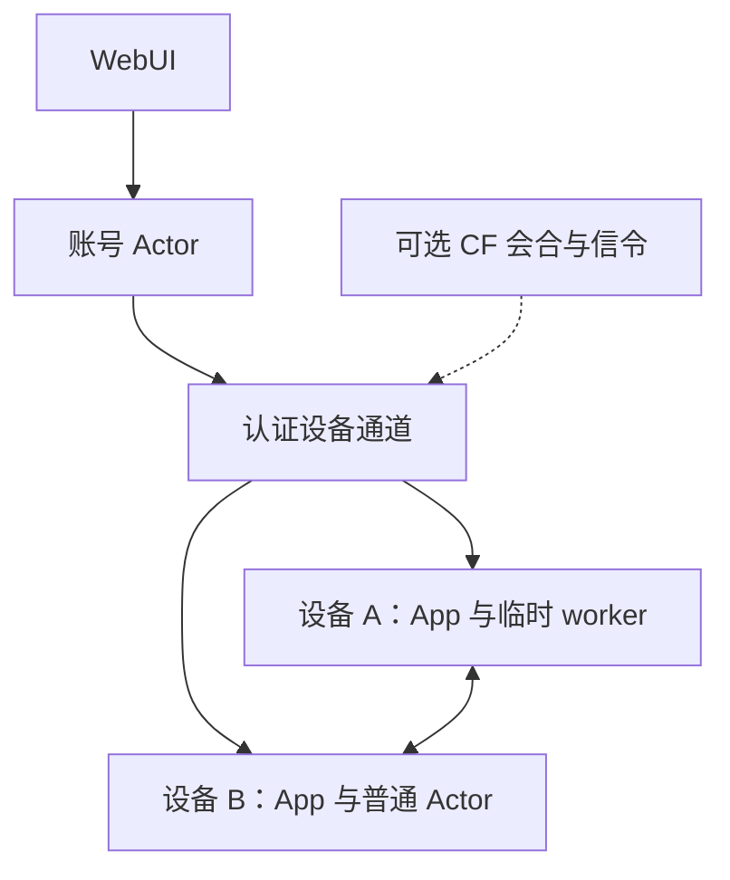

# 架构与接口

本文定义 Actor/App 系统的产品结构、执行与恢复策略，以及账号、设备和客户端接口契约。
工程约束见 [AGENTS.md](../AGENTS.md)；构建、测试与发布流程见[贡献指南](../CONTRIBUTING_zh-CN.md)。

## Actor 与 App

`Actor = Agent 核心 + 安装的 App 实例`。`src/actors` 负责串行收件箱、
模型执行、持久上下文、审批与回复；不同 Actor 并行推进。App 是唯一工具抽象，
各领域自行定义查询与操作，不要求统一 `get_state`。

业务数据不设固定总量配额：Actor 总数与所有权层级、导入对话的字节数、记录数和
消息数、MCP 安装与工具数、权限列表以及 Files/Skills 的扫描数量和深度均不以
常量截断或拒绝。内容缓存按目标容量回收冷数据，但不因单个资源大小或活跃传输
超过目标而拒收；快照和恢复归档不设历史总字节数配额。分页、单帧传输、背压、
认证防滥用、模型预算、文件访问和授权校验仍各自生效，分页大小不是业务总量上限。

`src/builtin_apps.rs` 安装 Actors、Files/Skills、Terminal、Browser、Artifacts。
各 App 的指令统一维护在 `src/app_instructions`，工具描述和可移植输入
schema 留在所属 App。Skills 是可发现、读取的指令资源，不拥有独立执行引擎。

Study 已移除。加载持久 Actor 配置时移除旧能力列表，普通 Actor 直接使用设备全量
App，Core 只构造 Actors App；保留身份、历史、输入和工作目录，不恢复旧应用。

`src/app_instructions/orchestration.md` 维护通用场景的 Actor 分工、复用、
工作区协作与结果验收策略，与 Core 和普通 Actors App 的指令共同编译并
注入模型上下文。它是模型的
决策指导，不引入固定工作流、调度引擎或额外授权，权限与持久路由仍由代码执行。

Actor 的创建、工作目录、App 安装集合和沙箱范围是内部状态。客户端只能切换
模型偏好与 Full access / Ask / Auto；模型不能修改批准模式。所有 Actor 持续
保留身份、配置、上下文与历史，没有单独删除入口。完成任务、退出账号、停止进程
或释放 App 资源不删除 Actor。

Owner 可在账号设置中确认重置整个账号的工作数据：先停止执行与审批，再清空全部
Actor、会话、历史、内部资源与权限，并按初始策略重建 Core。模型配置、账号凭据、
设备身份及连接、撤销记录、Raft 投票与成员关系和工作目录文件保留。重置记录由具备
账号授权能力的设备签名，由当前有权管理账号的设备发起或转发，与本机数据清理在
同一事务中保存；签名设备后来被撤销不回滚已生效的重置。内部 App 与附件文件的
清理标记在重启后继续完成。重置按单调修订与签名设备排序，连接在交换业务数据前
核对重置代次，离线旧副本先清理后重连，不能重新导入旧历史、权限或重放操作。
Raft 中的新代次清空旧执行租约与工作 head，不重建投票或成员关系，并保留已同步设备
的本地恢复资格。重置不提供模型
工具，不允许按 Actor 删除；客户端须输入账号名确认，重置后清除会话草稿并返回 Core。

提供商始终可删除，关联模型一并移除；仍有效的默认和审批模型选择保留，失效选择
按模型列表顺序回退，审批默认继承主模型。配置持久化成功后，使用已移除模型的
Actor 偏好回到账号默认，其他配置与历史不变。删除最后一个模型可以保存为未配置
状态，排队输入保留、推理不启动；私密设备同步传播相同定义。HTTP 保存使用服务
所属 profile 的配置与备份，不依赖进程全局配置目录。

OpenCode Console OAuth 在发送模型请求前解析工作区选择，成功后写回私有凭据文件，
由模型推理与模型目录查询共享。查询失败不发送缺少工作区标识的推理请求，也不缓存
不完整授权；保留认证、连接、限流与服务错误分类。凭据刷新先持久化新的令牌，
后续工作区查询失败仍保留已轮换的凭据。
Zen/Go 直接 URL 的 Chat、Responses 与 Anthropic 接口共享网关身份与失败分类；
模型不可用及地区拒绝立即终止，临时上游故障保留重试。工具别名只映射实际可用的
唯一 App 操作，保留设备前缀与原始约束，不补充不存在的执行能力。

Actor 的持久身份与 worker 驻留分离。启动、账号激活和恢复执行只查询有可执行
输入的收件箱；创建 Actor 和读取对话不会启动 worker。入队后按需激活，同一
Actor 仍只有一个串行 worker。没有输入持续 60 秒后，可安全重建的 App 关闭，
worker 与注册表条目释放；再次入队从 SQLite 加载配置、上下文锚点与历史。
空唤醒不延长空闲期限。收件箱的部分索引只包含排队输入，避免启动时扫描全部历史。

App 默认不允许空闲回收，必须明确声明自身可安全重建。Actors、Files、Artifacts
和只读 HTTP 缓存允许回收；终端保留会话或输出、浏览器保留上下文时阻止
回收，不杀进程、不丢页面或会话数据。终端使用随机唯一会话 ID，重建后不复用旧引用。
这些资源仍通过已有关闭操作或显式生命周期停止释放，空闲回收不重放 App 操作。
App 关闭期间 worker 仍占据注册表位置，关闭完成后移除并重查持久收件箱，避免
并行实例与丢失唤醒；暂停、重配置和退出在同一注册表锁下阻止新 worker。
共享 Core 的激活继续检查设备执行授权，无租约时保留输入而不驻留等待 worker。
Actor 列表在 SQLite 内按 ID 游标分页；容量、模型引用校验和私有目录边界查询
只读取计数、模型名或 ID，不加载全部配置。历史分页加载时直接借用消息计算预算，
只为通过预算检查的模型请求复制工作窗口，不为每页构造临时完整请求。

## 执行与恢复

SQLite 的事务同时提交消息变化和语义事件，稳定 ID 标识输入、工具调用、资源
和审批；全局事件游标单调递增。委派立即排队，结果关联原请求、原来源和交付
引用。入队时保存权限上限，接收者之后新增的权限不能被旧委派使用。

Actor 数据库使用 SQLite 自身的容量上限，不设置账号历史的固定 1 GiB 配额；
事件分页、单块文本和同步帧仍保持有界。模型进度的正文与思考事件只包含新增文本，
提供商在每次请求内分别记录已发送的 UTF-8 字节位置，结尾只补发未发送的尾段。
Anthropic 按通道缓冲实际增量；runner 合并增量后分块持久化，禁止把累计全文作为
增量重复追加。新请求和重试重新建立发送位置，草稿重置划分独立 generation。

核心使用同一个串行 inbox 和 Agent 循环，以短回合协调。Actors App 的 `deliver`
创建独立的 `delivery` 消息，其来源与收件人从当前输入构造，模型只能提供正文与
`finish_turn`。交付 ID 由 Actor、输入和调用 ID 确定，相同调用不会重复发送；
核心先保存交付记录并提交账号账本，再幂等发布消息事件和远端交付；未提交记录不进入会话查询，也不能作为恢复成功的凭据。`finish_turn=true` 在
整个工具协议组写完观察后关闭当前输入，无需再调用模型；不结束任何被委派工作。
已有显式交付时，最后的模型文字只关闭回合，避免重复用户消息。没有显式交付的
直接最终回答仍沿原收件人交付。普通 Actor 的 `report` 将重要进展关联原请求，
作为 `progress` 输入唤起请求方，而不修改执行中任务的状态。Core 自行选择汇报内容。

所有 Actor 的 Actors App 提供 `yield`：成功观察持久化、当前工具协议组完全结算后，
只关闭当前 inbox 输入，不生成最终正文、占位结果或远端交付，也不再请求模型。
它保留 Actor 身份、上下文和委派关联；后续协作者输入仍沿原请求唤醒并汇总。
`Completed` 表示该输入处理结束，不能据此断言其委派目标已全部完成。等待必要协作
时使用简短的重要进度和 `yield`；必要结果整合验证后才发送完整最终答复。
无新增事实的确认、重复发现及汇报后的常规回执静默处理，不发送“保持静默”等占位正文。

普通 Actor 的 WebUI 按助手正文划分活动组：跨模型轮次、仅夹有思考的连续工具
调用合并为一行摘要，展开后按原始调用顺序呈现，具体结果仍在点击对应调用时读取。
推理中的最新思考段落只临时替换当前活动组的单行标题，不提供完整思考正文的展开
入口；尚无工具时该标题不可展开，工具开始或推理结束后恢复活动摘要。

模型执行不限制消息数、ReAct 轮数或工具批次数。输入预算包含消息、工具定义、
参数、观察和输出预留。完整协议组保持平衡；上下文满时清空工作窗口，插入
读取归档历史的恢复提示，不压缩、不滑动裁剪。`read_history`、`read_resource`
只读取自身 Actor 的原请求、指导、观察和资源；历史是证据，不能成为新授权。

窗口清空锚点与按模型绑定的 token 校准持久化。每次成功请求使用新鲜的实际
input usage 保守校准；低观测值不降低估算，缺失 usage 不复用旧观测。
Commentary、仅 reasoning 的继续响应和多工具协议保持完整。请求重试有退避与
取消检查；连续无内容响应的错误保护不构成正常任务轮数上限。

取消中断模型和工具等待，不承诺回滚已经发生的外部效果。重启记录中断状态；
不能在取消、重启或接管后自动重放不明确的 App 效果。诊断保存到 Actor 私有
目录，凭据经过脱敏，客户端只收到安全错误码。

用户输入执行中继续排队。修改、撤回与引导检查消息所属 Actor、用户来源、
当前状态和 `expected_updated_at_ms`，事务内拒绝过期操作。引导绑定确切的
运行请求；目标结束时未应用的指导恢复为普通输入。清空只处理尚未执行的用户输入。

## 账号与设备

账号身份来自持久信任根公钥的指纹，账号名是登录名；同名不是同一身份的证明。
`--profile` 隔离本机账号、Stage 身份、凭据、配置与 Actor 数据。

浏览器和 Rust 使用同一 `daat-locus-auth` 实现 OPAQUE，采用 Ristretto255 /
SHA-512 / TripleDH / Argon2id。密码留在客户端，没有 Owner Token、Bearer
认证入口、配对码或人工设备加入界面。首台设备注册和空设备身份安装必须验证
本地 OS 所有者连接；loopback、Origin、Host 或 Forwarded 不能代替此验证。

空设备登录会寻找在线账号设备，经 OPAQUE 双向验证取得加密加入记录。上下文
绑定账号、来源、目标设备、公钥/TLS 指纹/一次性证明、Origin 与连接边界；
LAN 使用 TLS exporter，公网交换使用本次 nonce。HKDF / AES-256-GCM 使用
单次登录密钥保护身份和私有注册记录。本机安装校验成员链、账号命名空间和
凭据修订，再完成本机登录。Apps 不可读取这些记录。
公网会合挑战的客户端预检容忍最多 30 秒时钟偏差；签名保留服务端给出的原始截止时间，
Worker 仍按自己的时钟、原始 nonce 和截止时间拒绝过期或重放请求。
设备加入请求和成员凭据在设备及 Worker 验证时允许最多 30 秒的未来签发偏差；
此容差不延长凭据有效期，也不放宽撤销、签名和授权链验证。

浏览器使用随机 HttpOnly / SameSite=Strict cookie，HTTPS 附加 Secure。
Cookie 绑定确切 profile、账号公钥命名空间和凭据修订；最长 12 小时。退出、
到期与已知撤销使会话失效，每次 HTTP 操作、SSE 输出与心跳重新验证。
登录或退出不会改变 Actor 生命周期。没有访客分享、PIN、公开隧道或分享会话。

账号设备自动发现、连接、同步与重连。LAN 使用 mDNS 和认证 TLS；SSH 需要
明确目标；可选 CF Worker/DO 仅提供公网会合和 P2P 信令。LAN、SSH 和直连
不依赖 CF。发现提示只能提供候选，不能授予信任。设备名默认使用系统 hostname API。
公网 WebSocket 在 Android 上使用 WebPKI 与 Mozilla 公共根证书验证证书链、域名和有效期，
避免 JVM 验证库将缺少 OCSP 响应地址误判为证书吊销；其他平台使用 OS 证书验证。
设备间 TLS 仍按设备身份固定证书指纹，两种信任边界独立。
公网连接交错尝试 DNS 返回的 IPv4/IPv6 地址，间隔 250 毫秒并竞速完整 TLS/WebSocket
握手；单个地址卡住不会耗尽其他地址的连接机会，成功后取消其余尝试。
公网在线提示只有在本地成员账本验证后才触发自动连接；初次连接不依赖模型已配置、
执行 worker 已取得租约或新设备已加入投票成员，避免连接与同步相互等待。
启用公网 WSS 连接后，P2P 默认通过 Cloudflare 与 Google STUN 获取 NAT 地址候选，
以同一个 UDP 套接字的两次目标观测识别映射是否变化；显式配置的 STUN 地址优先使用。
LAN/SSH 不依赖 STUN。P2P 协商与连接失败进入有界退避并保留
诊断原因，不因一次设备连接失败终止所有公网信令；直连受网络限制时仍可能无法建立。
ICE 收集最多等待 5 秒后签发当前候选集合，不能因某个接口的 STUN 无响应而丢弃已有
可用候选；没有候选时明确失败。候选仍通过原有签名 SDP、DTLS 指纹与设备握手验证。
ICE 检查覆盖收集与连接等待窗口，不能在约 1.6 秒后停止探测再空等外层超时。
双方通过签名 SDP 的可选扩展声明已观测的公网 IPv4 与映射行为；只有一端映射稳定、
另一端映射变化时启用增强打洞。每台设备最多同时执行两次，单次最多 12 秒：变化侧
最多创建 128 个临时 UDP 套接字，稳定侧最多尝试 2048 个端口，先探测观测端口附近，
再随机探测。目标 IP 必须来自该对端签名 SDP 中已有的公网反射候选，不扩大到其他
地址或特权端口。观测不足、旧客户端或双方映射均变化时保持普通 ICE。
首个完整性校验成功且凭据匹配当前协商的 ICE 回应锁定物理套接字，立即停止增强探测；
超时、连接完成或关闭均释放其余临时套接字。DTLS、SCTP、后续业务与保活继续复用实际
打通的套接字，不通过重新绑定端口迁移，也不重放业务操作。Worker 仍只传递认证信令。
公网同步信令注册总等待不超过 10 秒，发送不超过 5 秒；每 15 秒主动发送带随机
nonce 的 WebSocket Ping，只接受匹配 Pong，30 秒未确认则关闭并重新注册。登录发布
连接和同步信令分别验证存活；业务同步仍只走认证的设备直连。LAN 失败转交公网
协商时先释放 LAN 的连接中状态，由公网尝试负责失败退避，不能提前将其设为退避。
监督器先注册唤醒再读取候选，避免新设备加入或信令恢复时丢失连接通知。私密登录
导入后立即保存已验证来源的名称并请求连接；对端名称随后经认证通道传播。未知
名称显示为未命名设备及 ID 前缀；设备列表仅返回固定连接错误码，不公开底层诊断。
RTC 协商签名采用 90 秒有效期，在验证端 120 秒未来上限内预留 30 秒时钟偏差空间；
过期、来源、目标、nonce、连接代数和 DTLS 指纹检查保持强制。
`workers/signaling` 是独立的可选部署单元，不是 quick-tunnel 子模块。

模型、提供商定义和可移植凭据在同账号内私密同步，拒绝回滚和同修订不同内容。
环境变量实际值、OAuth 文件路径、监听地址、公网连接地址和 SSH 目标保持
设备本地；语言、外观、草稿与展开状态是客户端偏好。配置页固定显示本机和账号设备
的名称及连接状态，使用有界分页自动刷新，不提供手动加入设备控件。离线设备在恢复连接后
补齐修订，无法即时获知离线期间的撤销。

## 共享账号 Actor

账号的默认入口为 `core` Actor。其身份、收件箱、模型上下文和对话属于账号，
不属于某一设备；设备提供 App 实例并临时承载 worker。普通 Actor 仍有宿主。
Core 是唯一预置 Actor。普通 Actor 由创建它的 Actor 命名，通过 Actors App
创建，不自动生成设备 root 或默认执行 Actor。设备默认工作区与能力约束属于
基础设施，不以 Actor 身份保存。既有本地 root 的身份和历史保留为普通 Actor，
不再具有特殊路由或权限，也不靠合并独立 root 来模拟共享 Actor。

核心直接工具固定为一个便携 Actors App：设备发现、分页 Actor 列表、创建、委派、
请求状态与取消，以及自身历史、资源和对话交付。模型使用明确的 `stage_id` 指定
普通 Actor 的宿主；原生 Core Invoke 仅允许 Actors 协作操作，不能转调 Files、
Terminal 或 Browser。构建模型工具不依赖逐设备网络目录查询；实际操作时重新检查
目标设备的目录修订、执行代际、权限与审批。读取操作目录先验证 worker 代际并同步
已提交的账号状态，再计算目录修订，避免执行前同步配置使刚读取的修订失效。
执行时仍重新校验修订，拒绝其间真实发生的权限变更。设备离线时不更换操作目标。

同设备的非 Core Actor 安装全量平台 App 与启用的 MCP App，创建工具不接受
`apps` 或只读身份。Core 只构造跨平台 Actors App，不安装其他 App，也不使用能力
白名单。`app_access`、工具白名单、委派 App 上限、本地只读身份和收件人列表均已
移除。普通 Actor 通过自己的项目沙箱和审批记忆执行；所有项目工作目录默认递归
可读写。项目 AGENTS 和 Skills 由普通 Actor 读取，不自动注入 Core 的模型上下文。
远端设备认证与只读授权仍在执行期独立校验，委派和审批记忆不能扩大远端授权。

执行协调属于账号设备。OpenRaft 持久化投票、日志、快照与联合成员变更，确认
执行代际、租约和共享提交头，正文走认证设备通道。新账号初始化一个授权节点，
后续设备为 learner；旧的多投票者成员通过原有 quorum 收束。同步副本不增加
日常运行的永久投票依赖。成员维护在独立循环中使用截止时间，不阻塞 worker 续租。
正常退出暂停并同步当前执行，再通过联合成员变更把授权节点交给已同步设备。
健康且可执行的 worker 保持亲和；不再具备执行条件时释放租约。状态查询返回后
重新读取本机提交头，不能因并发检查点让旧查询结果撤销健康 worker。输入就绪
门禁与已开始推理、工具调用及显式消息交付的执行权限分离；短暂同步未就绪不能撤销
仍有效的执行授权，后者仍严格检查租约、代际、暂停和退出。worker 完全
停止后，残留的运行中输入必须先恢复推理与不完整工具协议，再开放串行 inbox；
Actor 的暂时空闲状态不能绕过运行中输入。

异常失联时，已同步、授权和模型配置有效的设备无法取得账号仲裁确认时，在既有授权
失效后进入持久的本地恢复分支。副本之间仍在线不代表仲裁可用。分支有独立标识、
起始提交头和递增代际，不改写 Raft 投票者，也不宣称取得多数提交。个人账号选择
可用性优先，因此网络分区中各侧可能分别推理。
重连后，由现有账号授权节点暂停各侧执行，按检查点序号降序、StageID 升序选择
完整的推理上下文；后返回的旧代际分支仍参与恢复。替换前把原分支保存在同一个
私有数据库中，按分支分别映射消息和操作引用，把用户消息、完成结果与只读操作
记录自动合并到活动对话。相同输入的不同结果使用稳定标识保留，合并可重复执行；
不拼接有分叉的模型工具协议、不导入待批准操作。旧版尚未合并的归档也通过有界
原生分页自动补回。共享头由原有 quorum 确认后恢复执行并标记归档已合并；同步
期间续期暂停状态。未开始的输入保留约束并继续交付；其他分支中已开始或结果未知
的工作只保留已取消记录，不自动重放。客户端直接呈现合并后的正常对话，不提供
额外的恢复历史按钮。配置就绪查询读取当前生效配置；共享 Core 的模型定义就绪
与本机凭据可执行性分开，账号配置修订触发客户端模型列表刷新。
重启不恢复缓存租约，本地分支代际也递增。CF 不拥有租约、代际或业务提交权。

LAN 地址候选有过期时间并处理服务撤销，最多四路同时验证 TCP/TLS，整次拨号
有截止时间。失败记录原因、安排重试并唤醒调度，新发现可打断退避。连接静默
判定为六秒，写入也有截止时间；WebRTC 关闭和失败直接结束通道，短暂的 ICE
Disconnected 允许自行恢复，不能提前销毁仍可恢复的连接；失联仍受业务心跳截止时间约束。
公网 ICE 协商
在独立任务中进行，在线通知与心跳保持可处理。客户端区分连接、同步、恢复、
本地运行及恢复阻塞。等待使用原有居中环形加载与模糊遮罩，保持消息和草稿组件
挂载，暂时禁止对话交互；可用的本地恢复不额外显示提示条。完成分支合并后从
语义事件重新读取有界对话页面。

工具意图先复制提交，目标设备再检查代际、授权、审批和 sandbox。工具结果和
最终回复进入持久账本；可读取已确认结果，不重放 Unknown 效果。原 App 设备
离线不能把文件或终端操作静默改投另一设备。输入使用已提交逻辑顺序，检查点
保留窗口锚点、token 校准、上下文和资源引用，接管不重新填充已清空的窗口。

## 权限与资源

Auto 的独立模型请求无 worker 历史和执行工具，只能 approve/deny；超时、
错误和无效响应拒绝，不转人工。未指定审查模型时跟随账号主模型；沿用所选模型的
响应与流空闲超时，不附加固定 30 秒截止时间。默认流空闲超时仍为 900 秒，显式设置
不被默认值抬高。Ask 等待 Owner 审批不可修改的参数与请求范围。
App 通过 `review_requirement` 声明哪些操作需要审查、审查标准以及语义动作。
默认普通操作不审查；超出沙箱的读写范围独立触发审查，不依赖工具名。
Full access 省去审查并使用本次请求的额外文件范围。Ask/Auto 的正向决定通过
`ApprovalFingerprint` 写入 `actor_approval_scopes`，按 Actor 和本地设备隔离，
重启后保留。目录授权递归覆盖后代，写授权包含读权限；更宽范围合并已经覆盖的
较窄范围，不自动扩大到父目录、同级路径或写权限。文件授权只覆盖该文件。
App 指纹绑定命名空间、审查标准修订和有意义的目标/参数；协议调用 ID、等待时长
等无关参数不产生新授权。App 安装修订或审查标准改变后重新审查。旧单次批准不
自动转为长期授权。拒绝、取消及失败审查不写入记忆；清理 Actor 数据时通过外键
同步回收，不增加单个 Actor 删除接口。记忆独立于 Actor 配置，不跨 Actor 继承。
批准后自动记忆，不提供记忆开关或额外提示。只有手动审批显示操作、请求范围与
确认控件；自动审批不显示审批卡片。
远端认证范围、框架凭据和其他 Actor 私有数据不能被批准或记忆绕过；已批准路径
被替换成指向其他位置的符号链接时，不将旧批准重新绑定到新目标。
取消、停止和重配置使等待审批失效，未确认的外部效果仍不得重放。

文件操作在实际打开目标时验证策略，不依赖提前 canonicalize 后的字符串检查；
写入用 SHA256 版本校验。受限原生进程隔离不可用时必须拒绝，不能退回宿主执行。
Linux bwrap 在全部授权绑定挂载之后创建私有 `/dev` 和 PID namespace 对应的 `/proc`，
再应用只读例外与拒绝规则，避免可写 `/` 或重叠授权覆盖虚拟文件系统与只读例外。
随后建立全部拒读目录的 tmpfs 和文件遮罩，再将需要禁写的每个目录
遮罩逐一 remount 为只读；父挂载只读不能替代子 tmpfs 的禁写，也不能提前阻止
嵌套挂载点创建。Windows ACL 与 macOS Seatbelt 保留对应的父子路径拒绝规则。
Windows Terminal 在后台准备 AppContainer 权限，保留所有显式私有路径拒绝规则，并封闭私有文件的通用应用容器读取授权；
创建进程前重新检查启动取消。并发 ACL 准备在后台串行等待至多 5 秒，等待可取消；
没有权限变更的失败路径直接返回，不等待 ACL 回滚锁。修改 ACL 前先进行至多 32768 项、5 秒的范围检查；
过宽或含重解析点的范围返回错误，模型改用有界 Files 操作或缩小终端目录，
不得把沙箱准备失败降级为宿主执行。Chat 兼容流收到 finish_reason 后只短暂收取尾部用量，
不依赖 [DONE] 或连接关闭才交回执行权。重连活动视图从 tool_started 恢复未完成调用，
进入工具阶段后不再把前一段推理标为正在思考。
只读 Browser 使用有界 HTTP GET，验证 DNS、重定向与地址目标，不运行 Chrome /
页面 JavaScript、不继承环境凭据。私有存储写入前建立 OS-owner 权限并传播失败。

`src/resources.rs` 为本地与多设备使用统一资源描述：稳定 ID、版本、媒体类型、
哈希、长度和内容块引用，跨设备不传本地路径。资源通过所属 Actor 账本授权、
打开路径检查和哈希验证后读取。工具图片先捕获为持久资源，仅模型请求临时
解析成图片内容；模型接口不会重新打开未经验证的路径。完整输出同样归档为
资源，按 UTF-8 字节分页，保留原始内容。多设备 App 结果转交资源描述和内容块。

浏览器上传只提交资源 ID；服务端构造来源、回复与权限元数据。下载执行 Actor
授权与账本路径检查，HTML/SVG 使用无 same-origin 权限的 sandbox CSP。
签名与链接不能替代授权，凭据不能进入观察、同步公开内容或客户端诊断。

公网登录发布与 Core 执行独立。注册握手总时限 10 秒，发送时限 5 秒；
发布连接每 15 秒发送带随机标识的 WebSocket Ping，仅匹配的 Pong 确认保活，
30 秒未确认即关闭失活通道，按有界退避自动重新注册。网络变化、账号凭据变化
和公网地址修改唤醒重查，不复用旧注册状态。注册失败与 TLS、协议、授权、
心跳超时分别记录固定错误码；不记录账号私密材料或底层响应原文。
设置页显示实际公网登录状态，地址已保存不代表注册成功；状态查询失败显示未知。
这些状态是本机易失诊断事实，不进入 Actor 业务日志、模型上下文或复制账本。

登录失败使用固定的 `login_*` 错误码和不含凭据的短原因。发现层区分未配置
公网连接、公网服务不可达、未找到在线设备、设备连接失败和超时；认证层区分
账号或密码错误、尝试过期、设备撤销、凭据变化以及无法验证登录/加入信息。
账号名不存在与密码错误保持相同认证结果。HTTP 与原生账号桥保留相同错误码；
WebUI 根据中英文目录显示简短提示和可反馈的错误码，不显示底层诊断原文。
拒绝密码证明后只在候选耗尽时显示凭据错误，不能把后续网络失败改写为密码错误。

模型请求失败将固定错误码写入消息，底层 HTTP/TLS 原因、地址、请求计数和 token
预算只保存在受 OS Owner 权限保护且脱敏的诊断文件中。认证拒绝与证书吊销/验证
失败分别分类，永久失败不自动重试，也不降低证书验证。客户端只显示简短本地化
原因；旧消息的诊断原文不作为对话错误提示展示。共享 Core 消息由同一复制流传输，
不能再通过设备限定的普通 Actor 通知创建重复身份。

## MCP 与设备应用

标准 MCP 服务器使用官方 rmcp 客户端，安装后成为独立 App 实例；支持 Streamable
HTTP 和本机 stdio，Android 仅提供 HTTP。HTTP 使用独立客户端、不带浏览器 cookie、
禁止重定向；远端要求 HTTPS，本机环回地址允许 HTTP。stdio 使用 Actor 执行时的
强制进程沙箱、目录和受保护环境策略；预检结束、取消及 App 关闭会回收子进程。
安装记录与连接凭据原子写入 profile 私有 `apps.json`，不进入账号共享配置或观察。
公开查询省略令牌、环境变量、命令参数及 URL 查询串。

普通 Actor 安装 AppsManager；`list`、`inspect`、`refresh` 不声明动作审查。
`install`、`enable`、`close` 自行声明审查标准，指纹绑定实际连接、命令或安装修订。
MCP 适配 App 对远端调用声明审查，不把远端工具描述或只读提示当作授权。
停用立即拒绝新调用，已开始的调用允许完成。Core 继续仅构造 Actors App。

每个输入开始前对照目录修订；显式刷新在当前工具协议组的全部结果落盘后生效。
保留未变实例和资源，仅替换修订改变的 MCP 实例，不重启 Actor、不清空上下文、
不重放输入或外部效果。服务器工具变更通知在下一边界重新发现，发现变更后旧定义
不能执行。MCP 超时、断线和会话过期不自动重试工具调用。

保留服务器原始工具名和 JSON Schema。可移植 schema 直接暴露；其他 schema
通过可移植 `arguments_json` 对象封装，模型可用 inspect 读取原 schema，DL 在
审批和调用前校验解码值。缺省、null 和动态键保持原意。映射名包含稳定摘要，带
设备前缀后仍满足供应商的 64 字符限制。文本及结构化结果保留原文与类型；嵌入
资源进入 Actor 的授权资源账本，远端 `isError` 写入工具失败状态。

Owner 通过 `/v1/apps` 的有界搜索列表及安装接口、`/v1/apps/{id}` 的详情与单个
工具 schema 查询、`/v1/apps/{id}/state` 的修订保护启停管理本机应用。写操作检查
受信 Origin 与请求头。共享 WebUI 的 `/apps` 使用窄导航入口、无边框列表与连接
弹窗，不提供不存在的市场、OAuth、隧道或每个 App 的工作区页面。

## HTTP 与 WebUI

`src/service` 提供有界 Actor、消息、搜索、队列、工具结果、审批、资源、
配置和账号查询；`/v1/stages/{stage}/actors/{actor}` 经认证设备通道访问宿主。
对话链接只是定位符，Owner 可以直接访问任意 Actor。Cookie 写操作要求受信
Origin 和 `X-Daat-Request: 1`，不信任 Host/Forwarded，不使用宽泛 CORS。
账号 Core 启动时，将本机 root/Core 的既有 Actor 树补齐到已验证账号；已记录的
其他账号归属及其子树不被覆盖。新 Actor 继承父级归属，同账号设备无需逐个授权
即可访问。派遣结果的对话链接携带宿主设备 ID，旧 Core 结果通过原始设备参数
恢复定位。远端对话的模型就绪状态由宿主提供，客户端本机配置不阻止远端输入。

`/v1/stage/status` 仅返回当前 Core 同步、执行就绪与公网登录发布状态，每次查询重新认证。
WebUI 串行查询该小型状态；同步完成且存在有效 worker 时才开放 Core 输入，
并在同步完成后刷新模型选项。服务端对未就绪的 Core 发送返回 `503 core_not_ready`，
客户端保留草稿；已经接收的持久输入不丢弃。设备连接失败即显示离线，重试时间
独立保留；收到对端数据的等待超过 45 秒（3 个心跳周期）关闭失效通道。

`/v1/event-stream` 和 Actor 的 `event-stream` 发送小型语义事实与引用。
客户端从最后已消费游标恢复 SSE，先等待消费者接收事件再推进游标；注册唤醒
早于查询，每次输出与心跳重新认证，尊重背压。同步缺口触发有界重查；重连
不会反复传完整 runtime snapshot。工具正文和重资源仅在展开时获取。

Core 固定采用 IM，只显示明确用户交付、任务链接、决策与成果。其他 Actor
固定采用工作呈现，在桌面对话框和手机全屏中均使用同一种身份样式：普通正文、静默耗时
展开、细分活动与独立成果。活动按时间穿插在对话中，不使用嵌套滚动框。工具
参数用只读标记字段呈现；不以原始 JSON 或模型协议作为产品兜底。活动历史与
工具列表在展开且滚动接近分页边界时自动加载下一页；折叠后停止续页，加载失败
才显示重试操作，不提供“更多活动”分页按钮。

主窗口固定显示 Core。Actor 链接在桌面打开对话框，窄屏自动铺满视口，
左上返回上一层对话或主会话；会话不提供最大化切换。
进入 Actor 时直接查询最新一页并从底部原点显示，不先定位到任务的原始请求，
也不顺序加载旧页后再滚到底部。任务引用保留请求标识以显示状态；历史刻度导航
才定位指定消息。补载旧历史保留当前可见消息的位置。
搜索使用非模态悬浮栏，宽屏位于右上，窄屏位于上部居中；按有界查询过滤原消息流，
向上滚动继续加载较早的匹配项，不显示遮罩或独立结果目录。普通 Actor 在搜索期间
隐藏中间思考与工具活动，只保留实际对话；关闭搜索恢复此前阅读位置和完整活动。

主页面使用 52px 应用导航轨，手机使用模态导航侧拉栏，仅提供首页和账号/设置入口。
DL 只有一个 Core 主入口，不提供会话列表、“最近聊天”或常驻 Actor 目录。
搜索浮动在主内容右上角；主对话不显示固定品牌大标题或历史消息刻度导航。
Actor 引用仍打开对话框。非 Core 对话在足够宽的容器中提供本地已加载历史的
刻度跳转；按正文和输入框的实际留白显隐，空间接近不足时淡出，避免重叠，
全宽阅读同样适用，隐藏时关闭预览。刻度不占用消息区宽度。默认等长短条，深灰标记可见
消息范围；悬停或键盘聚焦只把目标条标黑，附近刻度逐级伸长，并预览该条
消息的原始请求及回复。密集刻度保持稳定的连续分组，不随滚动替换目标。
设置使用 `/settings/*` 整页分类和窄屏列表/详情导航，复用行、组、选单
和二级页面；常规设置语言，外观提供系统/浅色/深色预览、分模式的强调色/背景/前景和代码主题，以及界面/内容/代码字号、减少动态效果与全宽阅读。外观偏好只保存在当前客户端，立即应用于主窗口和 Actor 弹窗；旧偏好自动补齐默认值，配色校验保证文字可读，并提供恢复默认。提供商/模型编辑明确保存，其他设置串行窄 PATCH
自动保存。失败输入与待发送草稿保留。排队消息位于圆角输入框上方，附带附件、
修改、撤回和引导入口。模型与批准模式是输入偏好，不是 Actor 管理面板。

WebUI 文案维护在 `webui/src/locales/{zh-CN,en-US}.json`，使用 i18next /
react-i18next；默认选浏览器首个受支持语言，其他语言回退英文。常规设置可选择
跟随浏览器、中文、英文，自动保存并即时刷新。用户消息、文件与命令原文不翻译。

WebUI 与共享认证 WASM 独立构建到同一 `webui/dist`，Rust 构建脚本只消费产物。
Tauri 通过 frontendDist、本地资源协议与框架内置压缩提供原生页面；配套后台和
Android 核心关闭 embedded-webui，避免同一安装包重复携带资源。独立网页服务默认
启用 embedded-webui，按文件以 zstd 压缩嵌入，HTTP 按请求有界解压并返回原始字节；
HEAD 直接返回原始长度。无头服务关闭默认 feature，显式 `DAAT_LOCUS_BUILD_WEBUI=0`
仍可用于后台检查。模型目录以 zstd 嵌入，仅在首次需要编译时回退时流式解压解析，
优先使用已验证的运行时缓存，不保留一份完整解压文本。静态资源只来自编译时清单，
SPA 只匹配确切对话路径，未知 API 不返回 index.html。维护 CLI 用 clap 提前
解析参数；`serve` 前台运行，`start/status/stop/restart` 通过 profile 本地
OS-owner IPC 管理后台进程，不借用浏览器认证、不删除 Actor 数据。后台存活按 PID 与
进程启动时间识别，不依赖安装升级时可能被移动的映像路径；IPC 仍校验 OS Owner、
端点进程与实例身份。

Windows/macOS 的共用 Tauri 客户端位于 `clients/app/src-tauri`。窗口从配套 CLI
的 OS-owner IPC 状态取得并核对 profile、可执行文件与确切 loopback origin，
加载本地共享 WebUI，以受限原生传输复用后台 HTTP 查询和 SSE，不复制业务接口。
会话 cookie 保存在 profile 的 WebView cookie 存储，原生代码读写 HttpOnly cookie；
Android 使用系统 CookieManager。JS 无权选择服务 origin、注入 Cookie/Origin 或读取
Set-Cookie。上传和响应的 IPC 块均有界，避免 Android 的 JSON 二进制回退放大内存；
读块由消费者推进，取消会关闭请求，页面重载或后台 origin 变化使旧请求失效。
WebView 不授予 JavaScript 文件、进程或 shell 能力；外部链接打开系统浏览器，
授权资源经只允许 GET/HEAD 的 dl-resource 本地协议读取，仅接受 Actor 资源路径，
保持服务端逐块授权检查、响应大小上限和 HTML/SVG sandbox CSP，在无同源权限的
对话框中预览；该协议不代理其他 API，不向活动资源暴露会话或原生命令。
下载由 Rust 调用系统保存对话框（Android SAF），仅写入用户选择的目标；JS 只提交
已授权资源路径及建议名称，不接收目标路径，也没有通用文件系统/对话框权限。
Windows 和 macOS 14+ 使用 profile 独立 WebView 存储；更早 macOS 仍由服务端的
profile 与账号凭据版本绑定保证会话权限。

首次注册与未登录设备的账号接入使用有限的原生命令，经本机 OS-owner IPC 到同一
认证处理逻辑。原生权限只授予该 profile 的主窗口及本地应用页面，
资源预览无权调用。IPC 只处理未建立账号的 bootstrap，不能创建浏览器会话或修改已有
账号；普通 OPAQUE 登录仍由 HTTP 写入 HttpOnly cookie。公开 HTTP 不接受 native
标记、额外 Owner token 或仅凭 loopback 的注册权限。

客户端拥有原生窗口、托盘与主线程事件循环，后台不依赖 GUI。关窗仅隐藏，
退出客户端保留后台，服务维护通过 CLI 请求正常关闭。Windows 托盘仅提供
隐藏/打开窗口与退出客户端，使用支持键盘操作的原生大行距菜单。重复启动恢复
同一 profile 的窗口；后台重启后重连已核实的本机服务。CLI 与可选浏览器入口保留。
Android 将同一服务与 Actor/App 核心编译为 APK 内的 Rust 原生库，使用 OS 私有目录，
不启动桌面 daemon、CLI 子进程或独立 root。它可以创建账号并独立推理，也可以成为
同账号共享核心的执行设备。设备可为普通 Actor 提供 Actors、Files、HTTP Browser、Artifacts；账号 Core 直接仅用 Actors；
终端不安装，未实现的进程隔离始终拒绝。Files 使用目录句柄与实际打开 FD 校验，
Android 上以 O_PATH 遍历不可列举的系统祖先目录，仅在授权目标读取目录内容；
创建文件用 renameat2 的 RENAME_NOREPLACE 原子提交，避免 SELinux 禁止的硬链接，
并保持目标已存在时不能覆盖的保证。服务与工作目录相邻分开，WebView 的账号存储
也属于 Apps 不可访问的私有基础设施。
账号 bootstrap 只授予确切 loopback origin 主 WebView，普通登录仍写 HttpOnly cookie。
资源预览留在认证 WebView 的 sandbox dialog，外部链接交给系统浏览器。
Android 原生容器统一应用系统栏、刘海和键盘 inset，并消费已处理的 inset；
WebView 不应再次为同一安全区预留边距。移动抽屉与全屏 Actor 弹窗必须覆盖内容视口。

Android 与其他设备使用同样的执行、同步和投票规则，无移动设备专用成员类型。
新设备同步为 learner；投票权只在授权节点交接时通过 joint membership 转移。
离线设备不能实际投票；修改仲裁成员仍须一致性提交，不能各自按在线列表重算法定人数。
新建的单手机账号初始化持久化单节点仲裁；已有仲裁仍需原有 quorum，不能因设备
断线自行缩成单节点；失联恢复使用明确的本地分支。后台生命周期暂停推理并释放
执行租约，保留输入和中断记录，前台重新参与执行。消息通道保持独立，进程被
Android 回收后按持久化游标重连，不重放未知
App 效果。没有常驻后台服务保证，也不以关闭 sandbox 为代价嵌入 shell。

主窗口标题区与内容融为一体，不显示应用名或状态占位。Windows 使用无系统装饰的
窗口和共用界面中的窗口按钮、拖动区；macOS 使用透明覆盖标题栏与原生红黄绿按钮。
原生窗口命令只操作调用者的主窗口，权限绑定确切对话 origin/路径，不开放任意窗口
定位、文件或进程控制。浏览器入口不渲染窗口控制，关窗仍只隐藏，不停止 Actor。

### Conversation import

Local Codex sessions and archived sessions are discovered through a private filesystem
index, with bounded searchable pages and opaque source IDs. Selection checks file
freshness before and after a scope-checked read; credential files are never indexed.
Unsupported devices (including Android) advertise no import capability and hide
the settings category. Selected Codex rollout JSONL is parsed server-side.
Only user/assistant text is retained, without duplicated Codex event copies,
private reasoning, system/developer instructions, tool protocol or grants.
`GET /v1/imports` advertises availability; `GET /v1/imports/codex` lists sources.
`POST /v1/imports/codex/preview` accepts only a listed source ID and stores immutable, Actor-scoped conversation
evidence and returns its opaque resource ID, title and message count.
`POST /v1/imports/codex` submits it to Core through the normal durable user inbox,
using the resource identity for idempotency. Core reads the evidence and chooses
an explicit device, name and factual context through Actors `import_conversation`.
Creation inherits device/parent grants and the current workspace, retains the
original resource in the new Actor ledger, and leaves the inbox empty. Retrying
creation for that input returns the same Actor. Import inputs cannot create via
the ordinary tool, send/cancel delegated work, be edited or become steering.
They remain cancellable. No foreign effects are replayed or provider transcripts
injected into inference history. The shared WebUI renders a compact import card
from the attachment's semantic media type, including queue/search/history previews.
